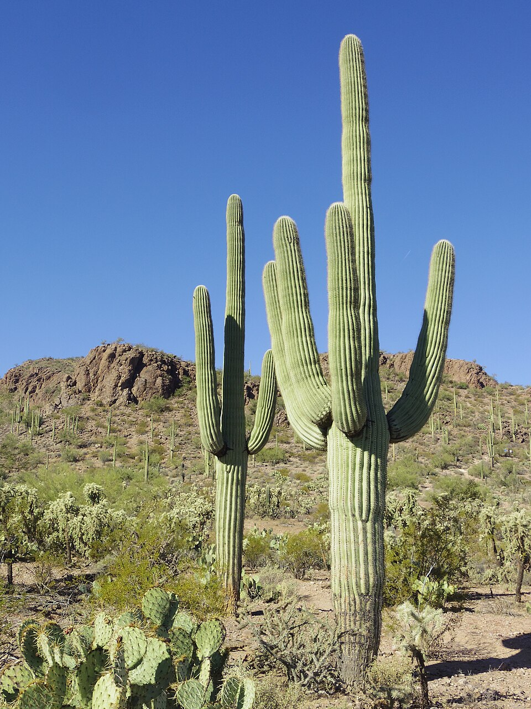
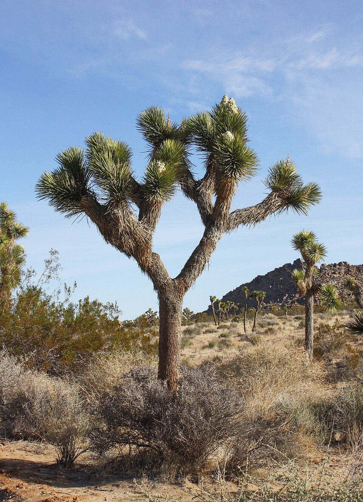
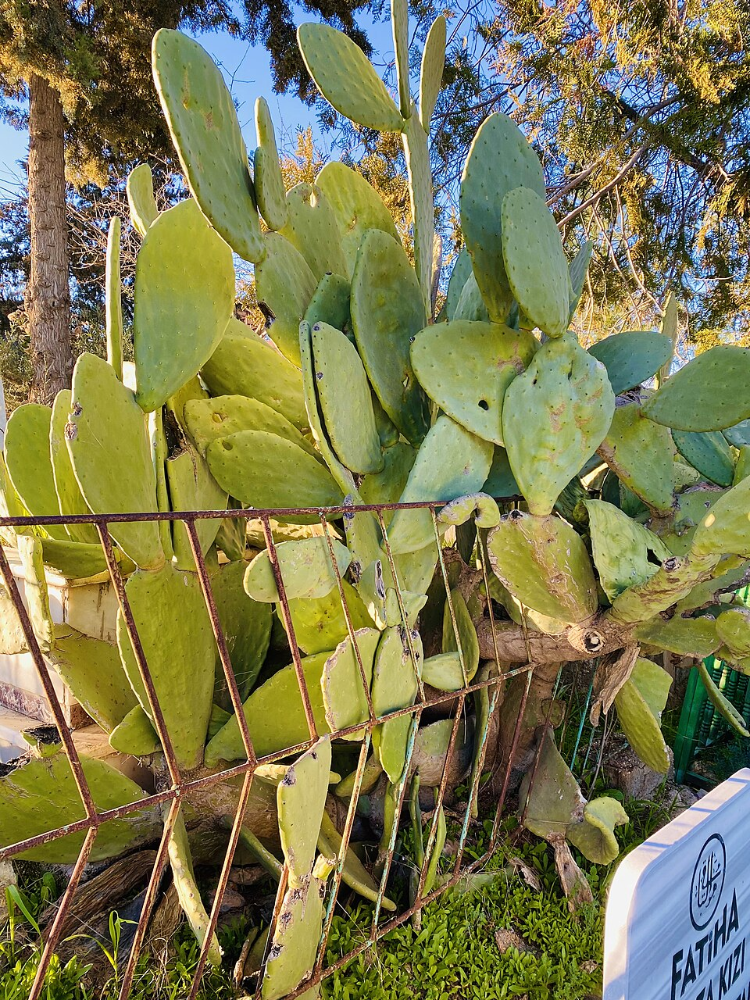
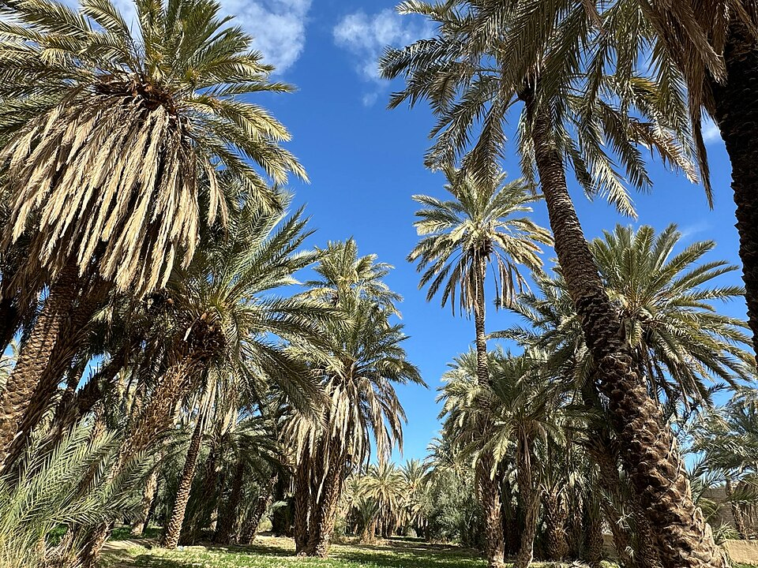
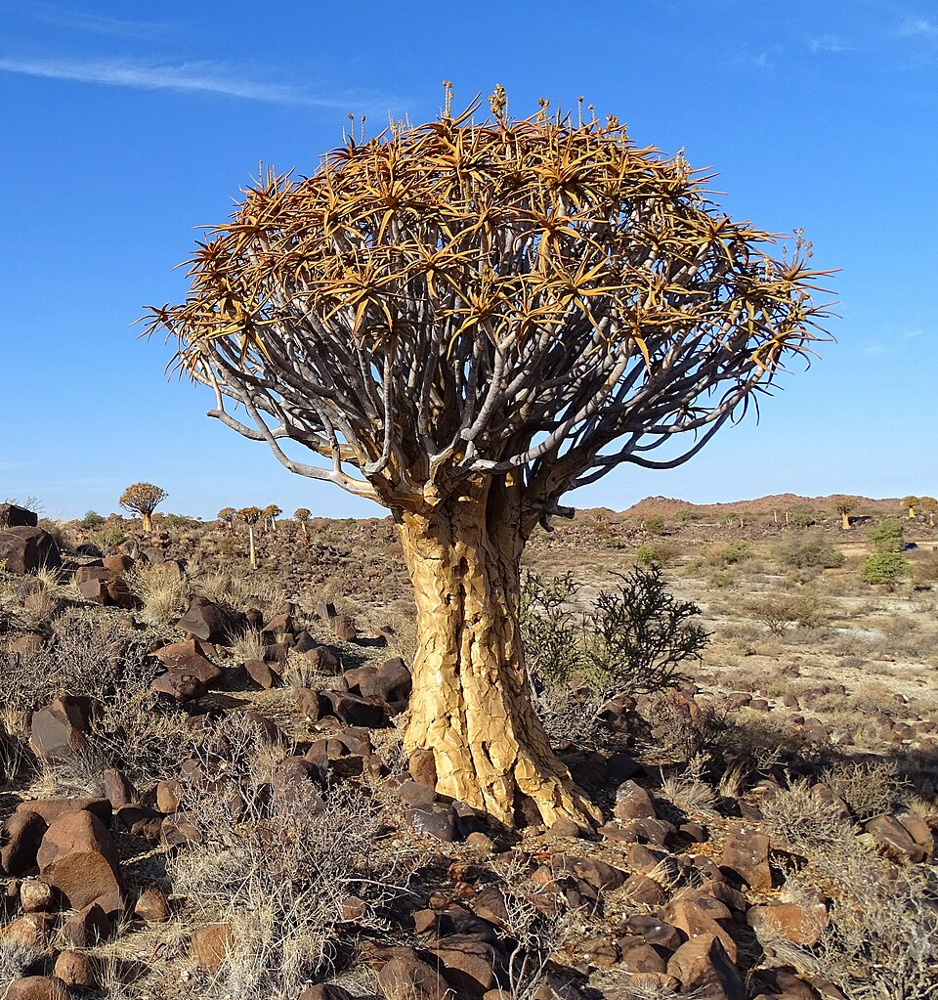
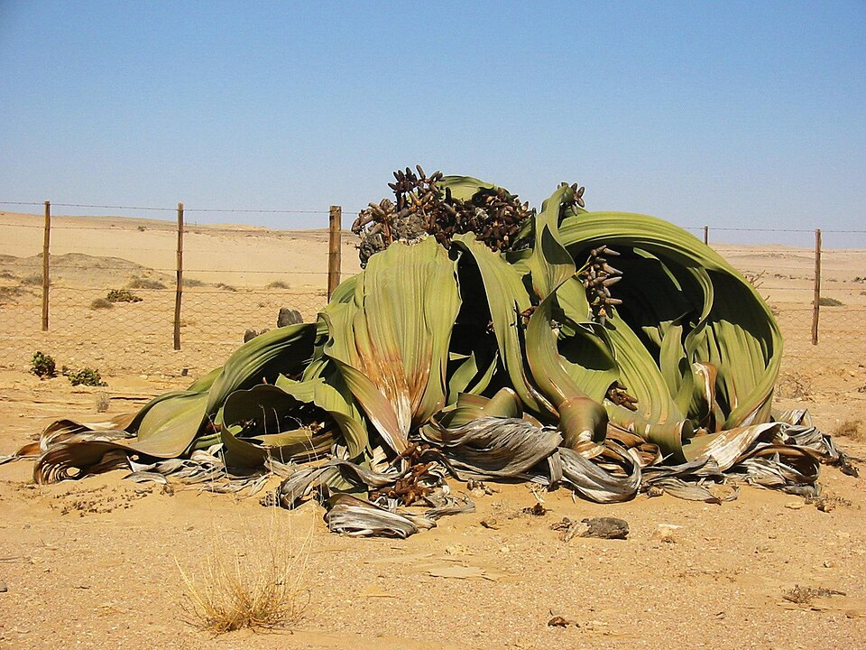

# Arid & desert — indicator species

**Climate signal:** these species indicate **Köppen BWh · BWk · BSh** — hot & cold deserts and semi-arid steppe. See the [Köppen-Geiger map & quick read](/wiki/identify/vegetation-climate/) to place the zone.

## Saguaro (*Carnegiea gigantea*)

{ width=340 }

**Geolocation tell:** ONLY the Sonoran Desert (Arizona/Sonora) — instant pinpoint

The saguaro is a tree-like cactus species in the monotypic genus Carnegiea that can grow to be over 12 meters tall. It is native to the Sonoran Desert in Arizona, the Mexican state of Sonora, and the Whipple Mountains and Imperial County areas of California. Saguaro typically grow at elevations ranging from sea level to 4,500 feet (1,400 m), although they may be found at up to 5,000 feet (1,500 m). The saguaro blossom is the state wildflower of Arizona. Its scientific name is given in honor of Andrew Carnegie. In 1933, Saguaro National Park, near Tucson, Arizona, was designated to help protect *([Wikipedia](https://en.wikipedia.org/wiki/Saguaro), CC BY-SA)*

[**⌖ live distribution map**](/app/index.html#species=5384200&name=Saguaro) · [POWO](https://powo.science.kew.org/results?q=Carnegiea%20gigantea) · [GBIF](https://www.gbif.org/species/5384200)

## Joshua tree (*Yucca brevifolia*)

{ width=340 }

**Geolocation tell:** Mojave Desert only (SE California/S Nevada)

Yucca brevifolia is a plant species belonging to the genus Yucca. It is tree-like in appearance, which is reflected in its common names. *([Wikipedia](https://en.wikipedia.org/wiki/Yucca_brevifolia), CC BY-SA)*

[**⌖ live distribution map**](/app/index.html#species=2775592&name=Joshua%20tree) · [POWO](https://powo.science.kew.org/results?q=Yucca%20brevifolia) · [GBIF](https://www.gbif.org/species/2775592)

## Prickly pear (*Opuntia ficus-indica*)

{ width=340 }

**Geolocation tell:** Mexico native; naturalized fences across Med/N. Africa/India

Opuntia ficus-indica, the Indian fig opuntia, fig opuntia, or prickly pear, is a species of cactus that has long been a domesticated crop plant grown in agricultural economies throughout arid and semiarid parts of the world. O. ficus-indica is the most widespread and most commercially important cactus. It is grown primarily as a fruit crop, and also for the vegetable nopales and other uses. Cacti are good crops for dry areas because they efficiently convert water into biomass. O. ficus-indica is the most widespread of the long-domesticated cactuses. Opuntia species hybridize easily, but the wi *([Wikipedia](https://en.wikipedia.org/wiki/Opuntia_ficus-indica), CC BY-SA)*

[**⌖ live distribution map**](/app/index.html#species=5384064&name=Prickly%20pear) · [POWO](https://powo.science.kew.org/results?q=Opuntia%20ficus-indica) · [GBIF](https://www.gbif.org/species/5384064)

## Date palm (*Phoenix dactylifera*)

{ width=340 }

**Geolocation tell:** Hot-desert oases: N. Africa, Gulf, Iran; California's Coachella

Phoenix dactylifera, commonly known as the date palm, is a flowering-plant species in the palm family Arecaceae, native to the region from the Gulf States to Pakistan. It is cultivated for its edible sweet fruit called dates. The species is widely cultivated across northern Africa, the Middle East, Australia, South and Southeast Asia, Portugal, Spain, coastal Mediterranean basin, and the desert regions of Southern California. It is naturalised in many tropical and subtropical regions worldwide. P. dactylifera is the type species of genus Phoenix, which contains 12–19 species of wild date palms *([Wikipedia](https://en.wikipedia.org/wiki/Date_palm), CC BY-SA)*

[**⌖ live distribution map**](/app/index.html#species=6109699&name=Date%20palm) · [POWO](https://powo.science.kew.org/results?q=Phoenix%20dactylifera) · [GBIF](https://www.gbif.org/species/6109699)

## Quiver tree (*Aloidendron dichotomum*)

{ width=340 }

**Geolocation tell:** Namibia/NW South Africa — a southern-Africa pinpoint

Aloidendron dichotomum, formerly Aloe dichotoma, the quiver tree or kokerboom, is a tall, branching species of succulent plant, indigenous to Southern Africa, specifically in the Northern Cape province of South Africa, and parts of Southern Namibia. *([Wikipedia](https://en.wikipedia.org/wiki/Aloidendron_dichotomum), CC BY-SA)*

[**⌖ live distribution map**](/app/index.html#species=9485745&name=Quiver%20tree) · [POWO](https://powo.science.kew.org/results?q=Aloidendron%20dichotomum) · [GBIF](https://www.gbif.org/species/9485745)

## Welwitschia (*Welwitschia mirabilis*)

{ width=340 }

**Geolocation tell:** Namib desert only; two ragged leaves on bare gravel

Welwitschia is a monotypic genus of gnetophytes containing only the species Welwitschia mirabilis. It is named after the Austrian botanist Friedrich Welwitsch, who documented the plant in the 1850s. In common use, it is sometimes referred to as the tree tumbo. It is native to Angola and Namibia, where it grows in the extreme conditions of the Namib desert, tolerating high heat and low precipitation. Welwitschia is the only living genus of the family Welwitschiaceae and order Welwitschiales, and is one of three extant genera of gnetophytes, alongside Gnetum and Ephedra. *([Wikipedia](https://en.wikipedia.org/wiki/Welwitschia), CC BY-SA)*

[**⌖ live distribution map**](/app/index.html#species=5275521&name=Welwitschia) · [POWO](https://powo.science.kew.org/results?q=Welwitschia%20mirabilis) · [GBIF](https://www.gbif.org/species/5275521)
