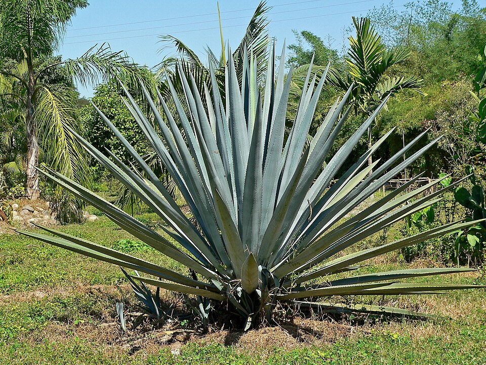

# Crops & landscape — indicator species

## Rapeseed (*Brassica napus*)

**Geolocation tell:** Blinding yellow spring fields: N/C Europe, Canada, China

[**⌖ live distribution map**](/app/index.html#species=3042636&name=Rapeseed) · [POWO](https://powo.science.kew.org/results?q=Brassica%20napus) · [GBIF](https://www.gbif.org/species/3042636)

## Sunflower (*Helianthus annuus*)

**Geolocation tell:** Summer fields: Ukraine/Russia/France/Argentina/US plains

[**⌖ live distribution map**](/app/index.html#species=9206251&name=Sunflower) · [POWO](https://powo.science.kew.org/results?q=Helianthus%20annuus) · [GBIF](https://www.gbif.org/species/9206251)

## Grapevine (*Vitis vinifera*)

**Geolocation tell:** Trellis rows; pergola-trained = N. Portugal/Galicia/Argentina

[**⌖ live distribution map**](/app/index.html#species=5372392&name=Grapevine) · [POWO](https://powo.science.kew.org/results?q=Vitis%20vinifera) · [GBIF](https://www.gbif.org/species/5372392)

## Hops (*Humulus lupulus*)

**Geolocation tell:** 6-m pole trellises = Bavaria/Czechia/Slovenia/US PNW

[**⌖ live distribution map**](/app/index.html#species=2984535&name=Hops) · [POWO](https://powo.science.kew.org/results?q=Humulus%20lupulus) · [GBIF](https://www.gbif.org/species/2984535)

## Sugarcane (*Saccharum officinarum*)

**Geolocation tell:** Tall cane fields: Brazil/India/Caribbean/Queensland/Fiji

[**⌖ live distribution map**](/app/index.html#species=2703912&name=Sugarcane) · [POWO](https://powo.science.kew.org/results?q=Saccharum%20officinarum) · [GBIF](https://www.gbif.org/species/2703912)

## Agave (tequila) (*Agave tequilana*)

{ width=340 }

**Geolocation tell:** Blue-grey spiky rows = Jalisco, Mexico

Agave tequilana, commonly called blue agave or tequila agave, is an agave plant that is an important economic product of Jalisco state of Mexico, due to its role as the base ingredient of tequila. The high production of inulin in the core of the plant is the main characteristic that makes it suitable for the preparation of alcoholic beverages. *([Wikipedia](https://en.wikipedia.org/wiki/Blue_agave), CC BY-SA)*

[**⌖ live distribution map**](/app/index.html#species=2766899&name=Agave%20%28tequila%29) · [POWO](https://powo.science.kew.org/results?q=Agave%20tequilana) · [GBIF](https://www.gbif.org/species/2766899)
