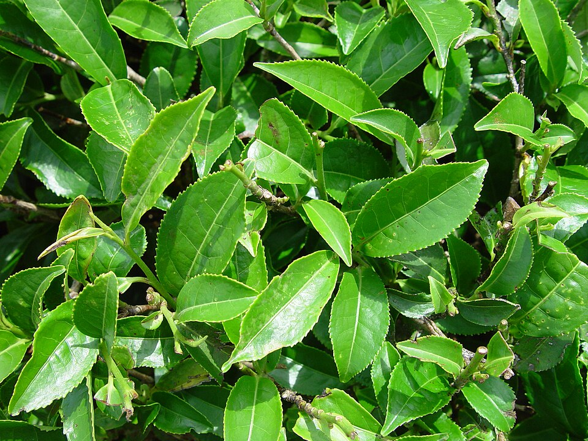

# East Asia — indicator species

## Japanese cedar (*Cryptomeria japonica*)

{ width=340 }

**Geolocation tell:** Japan's plantation conifer (sugi) — straight dark ranks on every hillside

Cryptomeria is a monotypic genus of conifer in the cypress family Cupressaceae. It includes only one species, Cryptomeria japonica. It is considered to be endemic to Japan, where it is known as Sugi . The tree is also called Japanese cedar or Japanese redwood in English. It has been extensively introduced, and cultivated for wood production on the Azores and elsewhere. *([Wikipedia](https://en.wikipedia.org/wiki/Cryptomeria), CC BY-SA)*

[**⌖ live distribution map**](/app/index.html#species=5284237&name=Japanese%20cedar) · [POWO](https://powo.science.kew.org/results?q=Cryptomeria%20japonica) · [GBIF](https://www.gbif.org/species/5284237)

## Ginkgo (*Ginkgo biloba*)

{ width=340 }

**Geolocation tell:** Fan leaves, gold in autumn; street tree of Japan/Korea/China cities

Ginkgo biloba, commonly known as ginkgo, also known as the maidenhair tree, and often misspelled "gingko" is a species of gymnosperm tree native to East Asia. It is the last living species in the order Ginkgoales, which first appeared over 290 million years ago. Fossils similar to the living species, belonging to the genus Ginkgo, extend back to the Middle Jurassic epoch about 170 million years ago. The tree was cultivated early in human history, remains commonly planted, and is widely regarded as a living fossil. *([Wikipedia](https://en.wikipedia.org/wiki/Ginkgo_biloba), CC BY-SA)*

[**⌖ live distribution map**](/app/index.html#species=2687885&name=Ginkgo) · [POWO](https://powo.science.kew.org/results?q=Ginkgo%20biloba) · [GBIF](https://www.gbif.org/species/2687885)

## Tea (*Camellia sinensis*)

{ width=340 }

**Geolocation tell:** Corduroy hedge rows on hills: China/Japan/India/Sri Lanka/Kenya

Camellia sinensis is a species of evergreen shrub or small tree in the flowering plant family Theaceae. Its leaves, leaf buds, and stems are used to produce tea. Common names include tea plant, tea shrub, and tea tree. *([Wikipedia](https://en.wikipedia.org/wiki/Camellia_sinensis), CC BY-SA)*

[**⌖ live distribution map**](/app/index.html#species=3189635&name=Tea) · [POWO](https://powo.science.kew.org/results?q=Camellia%20sinensis) · [GBIF](https://www.gbif.org/species/3189635)

## Moso bamboo (*Phyllostachys edulis*)

**Geolocation tell:** Giant bamboo groves of China/Japan

[**⌖ live distribution map**](/app/index.html#species=5290168&name=Moso%20bamboo) · [POWO](https://powo.science.kew.org/results?q=Phyllostachys%20edulis) · [GBIF](https://www.gbif.org/species/5290168)

## Rice (*Oryza sativa*)

**Geolocation tell:** Paddies = monsoon Asia; terraces = S. China/SE Asia/Philippines/Nepal

[**⌖ live distribution map**](/app/index.html#species=2703459&name=Rice) · [POWO](https://powo.science.kew.org/results?q=Oryza%20sativa) · [GBIF](https://www.gbif.org/species/2703459)
