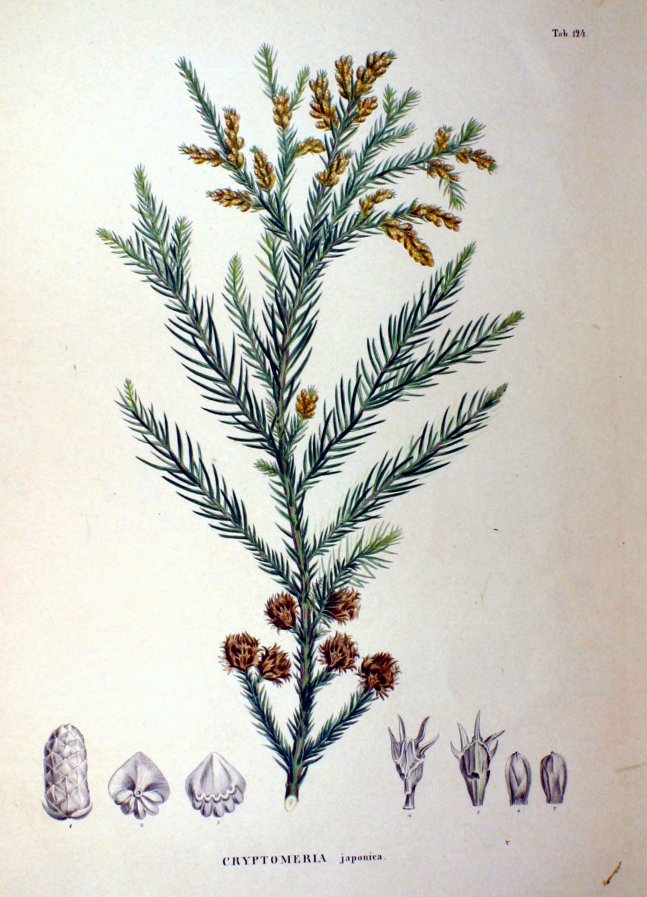
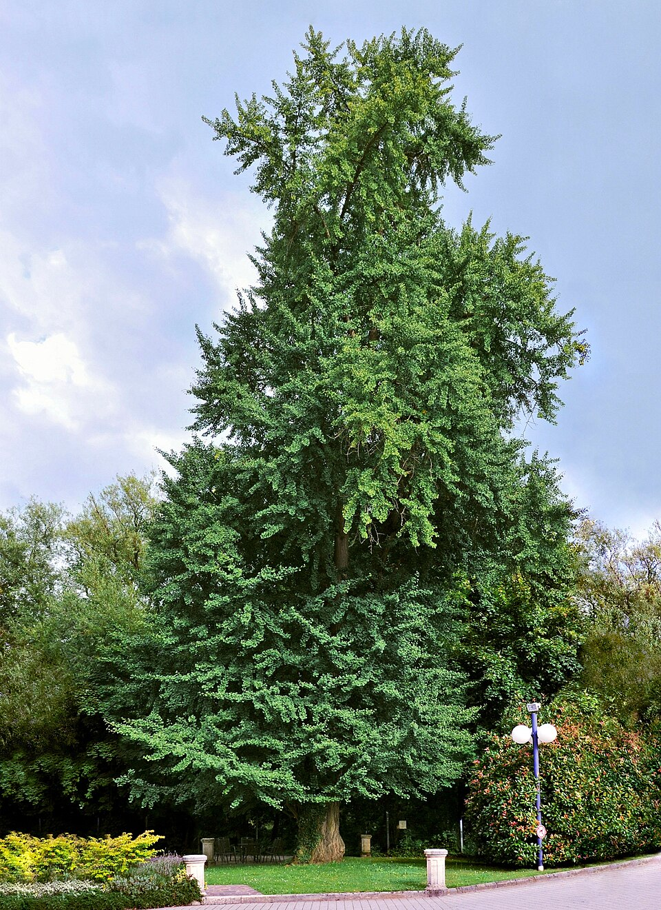
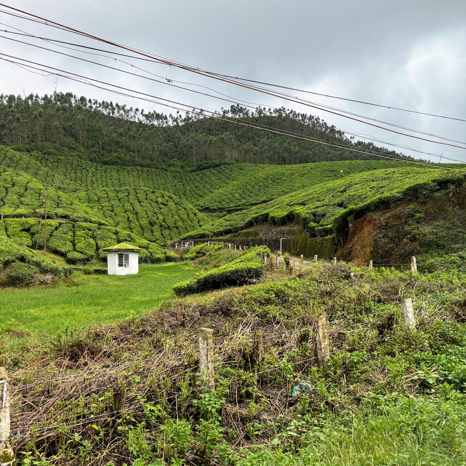
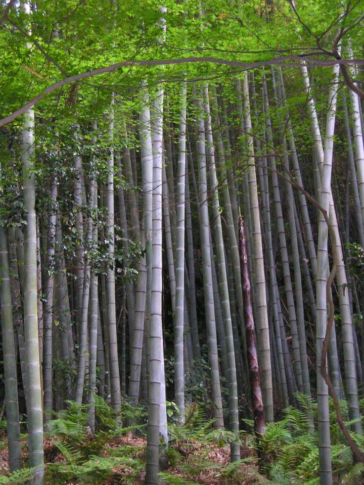
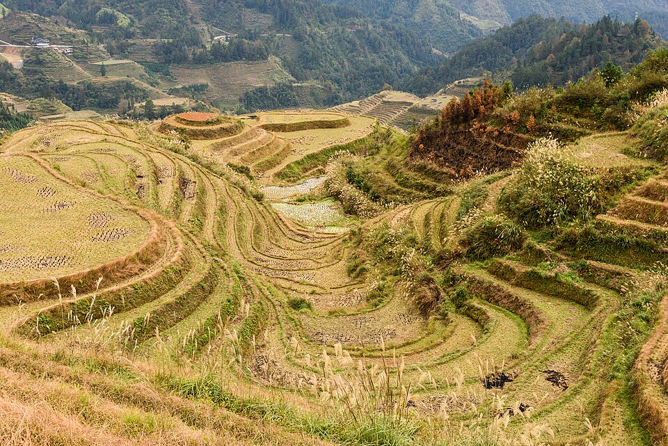

# East Asia — indicator species

**Climate signal:** these species indicate **Köppen Cfa · Cwa · Dwa** — humid subtropical & monsoon East Asia. See the [Köppen-Geiger map & quick read](/wiki/identify/vegetation-climate/) to place the zone.

## Japanese cedar (*Cryptomeria japonica*)

{ width=340 }

**Geolocation tell:** Japan's plantation conifer (sugi) — straight dark ranks on every hillside

Cryptomeria is a monotypic genus of conifer in the cypress family Cupressaceae. It includes only one species, Cryptomeria japonica. It is considered to be endemic to Japan, where it is known as Sugi . The tree is also called Japanese cedar or Japanese redwood in English. It has been extensively introduced, and cultivated for wood production on the Azores and elsewhere. *([Wikipedia](https://en.wikipedia.org/wiki/Cryptomeria), CC BY-SA)*

[**⌖ live distribution map**](/app/index.html#species=5284237&name=Japanese%20cedar) · [POWO](https://powo.science.kew.org/results?q=Cryptomeria%20japonica) · [GBIF](https://www.gbif.org/species/5284237)

## Ginkgo (*Ginkgo biloba*)

{ width=340 }

**Geolocation tell:** Fan leaves, gold in autumn; street tree of Japan/Korea/China cities

Ginkgo biloba, commonly known as ginkgo, also known as the maidenhair tree, and often misspelled "gingko" is a species of gymnosperm tree native to East Asia. It is the last living species in the order Ginkgoales, which first appeared over 290 million years ago. Fossils similar to the living species, belonging to the genus Ginkgo, extend back to the Middle Jurassic epoch about 170 million years ago. The tree was cultivated early in human history, remains commonly planted, and is widely regarded as a living fossil. *([Wikipedia](https://en.wikipedia.org/wiki/Ginkgo_biloba), CC BY-SA)*

[**⌖ live distribution map**](/app/index.html#species=2687885&name=Ginkgo) · [POWO](https://powo.science.kew.org/results?q=Ginkgo%20biloba) · [GBIF](https://www.gbif.org/species/2687885)

## Tea (*Camellia sinensis*)

{ width=340 }

**Geolocation tell:** Corduroy hedge rows on hills: China/Japan/India/Sri Lanka/Kenya

Camellia sinensis is a species of evergreen shrub or small tree in the flowering plant family Theaceae. Its leaves, leaf buds, and stems are used to produce tea. Common names include tea plant, tea shrub, and tea tree. *([Wikipedia](https://en.wikipedia.org/wiki/Camellia_sinensis), CC BY-SA)*

[**⌖ live distribution map**](/app/index.html#species=3189635&name=Tea) · [POWO](https://powo.science.kew.org/results?q=Camellia%20sinensis) · [GBIF](https://www.gbif.org/species/3189635)

## Moso bamboo (*Phyllostachys edulis*)

{ width=340 }

**Geolocation tell:** Giant bamboo groves of China/Japan

Phyllostachys edulis, the mōsō bamboo, or tortoise-shell bamboo, or mao zhu, , is a temperate species of giant timber bamboo native to China and Taiwan and naturalised elsewhere, including Japan where it is widely distributed from south of Hokkaido to Kagoshima. The edulis part of the Latin name refers to its edible shoots. This bamboo can reach heights of up to 28 m (92 ft). This particular species of bamboo is the most common species used in the bamboo textile industry of China and other countries, for the production of rayon. Moso is less cold-hardy than many Phyllostachy, surviving at a re *([Wikipedia](https://en.wikipedia.org/wiki/Phyllostachys_edulis), CC BY-SA)*

[**⌖ live distribution map**](/app/index.html#species=5290168&name=Moso%20bamboo) · [POWO](https://powo.science.kew.org/results?q=Phyllostachys%20edulis) · [GBIF](https://www.gbif.org/species/5290168)

## Rice (*Oryza sativa*)

{ width=340 }

**Geolocation tell:** Paddies = monsoon Asia; terraces = S. China/SE Asia/Philippines/Nepal

Rice is a cereal grain and, in its domesticated form, is the staple food of over half of the world's population, particularly in Africa and Asia. Rice is the seed of the grass species Oryza sativa —or, less commonly, Oryza glaberrima. Asian rice was domesticated in China some 13,500 to 8,200 years ago; African rice was domesticated independently in West Africa about 3,000 years ago. Rice has become commonplace in many cultures worldwide; in 2023, 800 million tons were produced, placing it third after sugarcane and maize. Only some 8% of rice is traded internationally. China, India, and Indones *([Wikipedia](https://en.wikipedia.org/wiki/Rice), CC BY-SA)*

[**⌖ live distribution map**](/app/index.html#species=2703459&name=Rice) · [POWO](https://powo.science.kew.org/results?q=Oryza%20sativa) · [GBIF](https://www.gbif.org/species/2703459)
