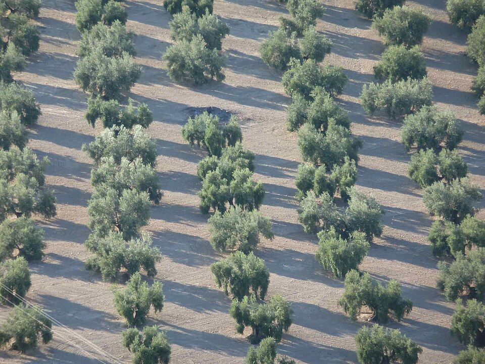
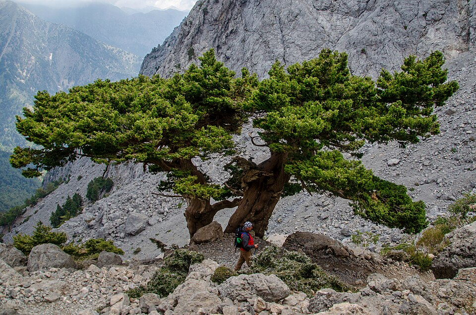
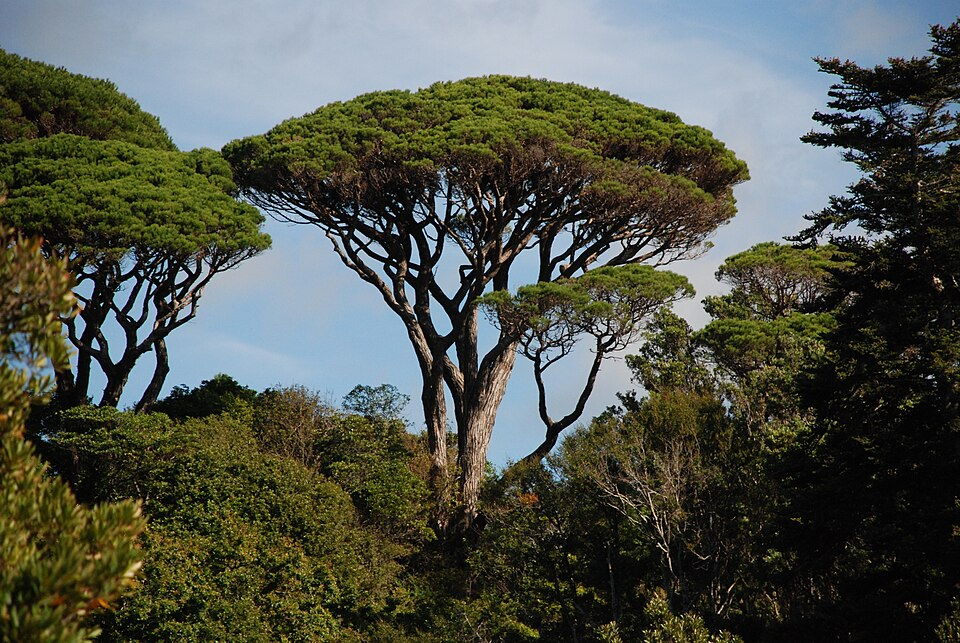
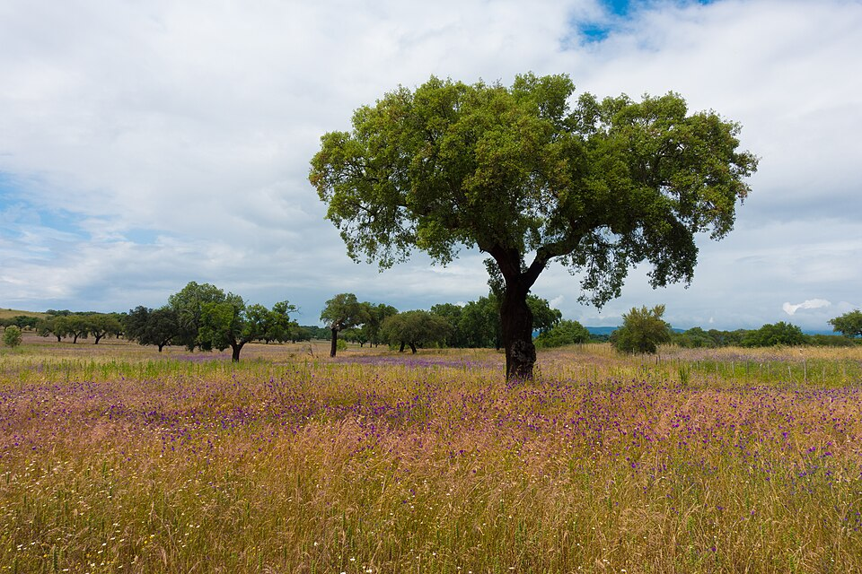
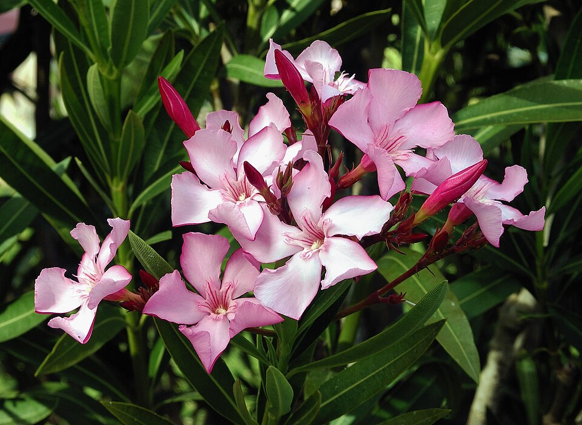
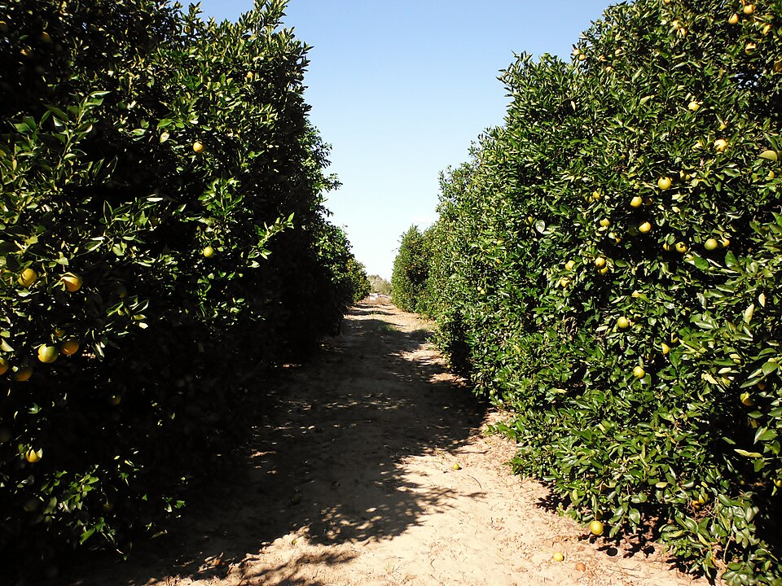

# Mediterranean — indicator species

**Climate signal:** these species indicate **Köppen Csa · Csb** — Mediterranean (dry-summer). See the [Köppen-Geiger map & quick read](/wiki/identify/vegetation-climate/) to place the zone.

## Olive (*Olea europaea*)

{ width=340 }

**Geolocation tell:** Silvery groves = Mediterranean climate worldwide

The olive is a species of subtropical evergreen tree in the family Oleaceae. Originating in Asia Minor, it is abundant throughout the Mediterranean Basin, with wild subspecies in Africa and western Asia; modern cultivars are traced primarily to the Near East, Aegean Sea, and Strait of Gibraltar. The olive is the type species for its genus, Olea, and lends its name to the Oleaceae plant family, which includes lilac, jasmine, forsythia, and ash. The olive fruit is classed botanically as a drupe, similar in structure and function to the cherry or peach. The term oil was originally synonymous with *([Wikipedia](https://en.wikipedia.org/wiki/Olive), CC BY-SA)*

[**⌖ live distribution map**](/app/index.html#species=5415040&name=Olive) · [POWO](https://powo.science.kew.org/results?q=Olea%20europaea) · [GBIF](https://www.gbif.org/species/5415040)

## Mediterranean cypress (*Cupressus sempervirens*)

{ width=340 }

**Geolocation tell:** Black-green exclamation marks of Tuscany/Greece; cemetery tree

Cupressus sempervirens, is a species of cypress native to the eastern Mediterranean region and Iran. It is widespread throughout the Mediterranean basin and has become endemic in similar dry summer climates due to its ability to survive in both acidic and alkaline soils and withstand drought. *([Wikipedia](https://en.wikipedia.org/wiki/Cupressus_sempervirens), CC BY-SA)*

[**⌖ live distribution map**](/app/index.html#species=2684030&name=Mediterranean%20cypress) · [POWO](https://powo.science.kew.org/results?q=Cupressus%20sempervirens) · [GBIF](https://www.gbif.org/species/2684030)

## Stone pine (*Pinus pinea*)

{ width=340 }

**Geolocation tell:** Umbrella-shaped crowns over Rome/Iberian coasts

Pinus pinea, the Italian stone pine or Mediterranean stone pine, is a tree from the pine family, Pinaceae. The tree is native to the Mediterranean region, occurring in Southern Europe and the Levant. The species was introduced into North Africa millennia ago, and is also naturalized in the Canary Islands, South Africa and New South Wales. *([Wikipedia](https://en.wikipedia.org/wiki/Pinus_pinea), CC BY-SA)*

[**⌖ live distribution map**](/app/index.html#species=5285165&name=Stone%20pine) · [POWO](https://powo.science.kew.org/results?q=Pinus%20pinea) · [GBIF](https://www.gbif.org/species/5285165)

## Cork oak (*Quercus suber*)

{ width=340 }

**Geolocation tell:** Stripped red-brown trunks = Portugal/SW Spain dehesa, Sardinia, Maghreb

Quercus suber, commonly called the cork oak, is a medium-sized, evergreen oak tree in the section Quercus sect. Cerris. It is the primary source of cork for wine bottle stoppers and other uses, such as cork flooring and as the cores of cricket balls. It is native to southwest Europe and northwest Africa. In the Mediterranean basin the tree is an ancient species with fossil remnants dating back to the Tertiary period. It can survive for as long as two centuries. Typically, once it reaches 25 years old, its thick bark can be harvested for cork every 9 to 12 years without causing harm to the tree *([Wikipedia](https://en.wikipedia.org/wiki/Quercus_suber), CC BY-SA)*

[**⌖ live distribution map**](/app/index.html#species=2879411&name=Cork%20oak) · [POWO](https://powo.science.kew.org/results?q=Quercus%20suber) · [GBIF](https://www.gbif.org/species/2879411)

## Oleander (*Nerium oleander*)

{ width=340 }

**Geolocation tell:** Pink/white highway median shrub in every Mediterranean climate

Nerium oleander, commonly known as oleander, rose laurel, be-still tree or rosebay, is a shrub or small tree cultivated worldwide in temperate and subtropical areas as an ornamental and landscaping plant. It is the only species currently classified in the genus Nerium, belonging to subfamily Apocynoideae of the dogbane family Apocynaceae. It is so widely cultivated that no precise region of origin has been identified, though it is usually associated with the Mediterranean Basin. *([Wikipedia](https://en.wikipedia.org/wiki/Nerium), CC BY-SA)*

[**⌖ live distribution map**](/app/index.html#species=3169756&name=Oleander) · [POWO](https://powo.science.kew.org/results?q=Nerium%20oleander) · [GBIF](https://www.gbif.org/species/3169756)

## Citrus (orange) (*Citrus × sinensis*)

{ width=340 }

**Geolocation tell:** Street oranges = Seville/Athens/Valencia; groves = subtropics

The orange, also called sweet orange to distinguish it from the bitter orange, is the fruit of a tree in the family Rutaceae. Botanically, this is the hybrid Citrus × sinensis, between the pomelo and the mandarin orange. The chloroplast genome, and therefore the maternal line, is that of pomelo. Hybrids of the sweet orange form later types of mandarin and the grapefruit. The sweet orange has had its full genome sequenced. *([Wikipedia](https://en.wikipedia.org/wiki/Orange_(fruit)), CC BY-SA)*

[**⌖ live distribution map**](/app/index.html#species=3190158&name=Citrus%20%28orange%29) · [POWO](https://powo.science.kew.org/results?q=Citrus%20%C3%97%20sinensis) · [GBIF](https://www.gbif.org/species/3190158)
