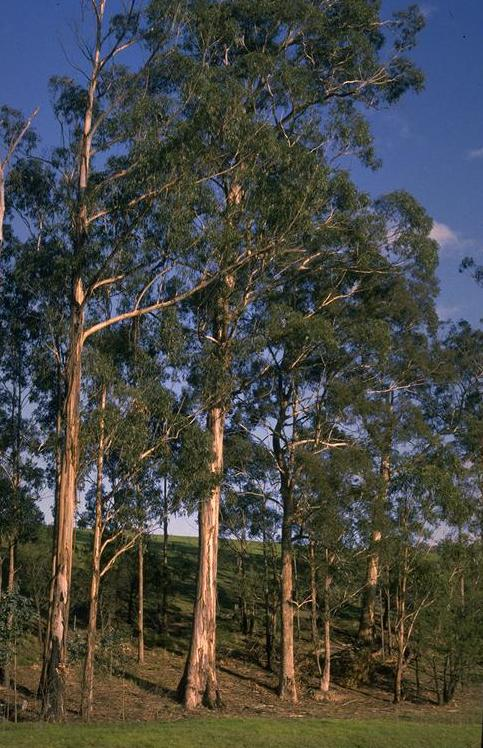
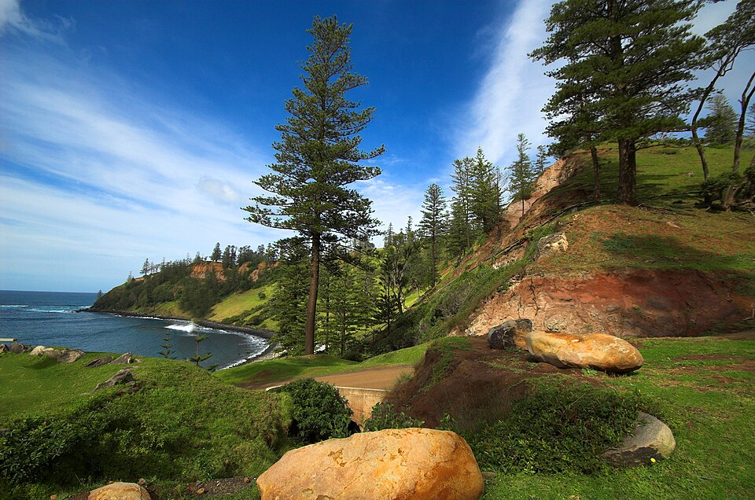
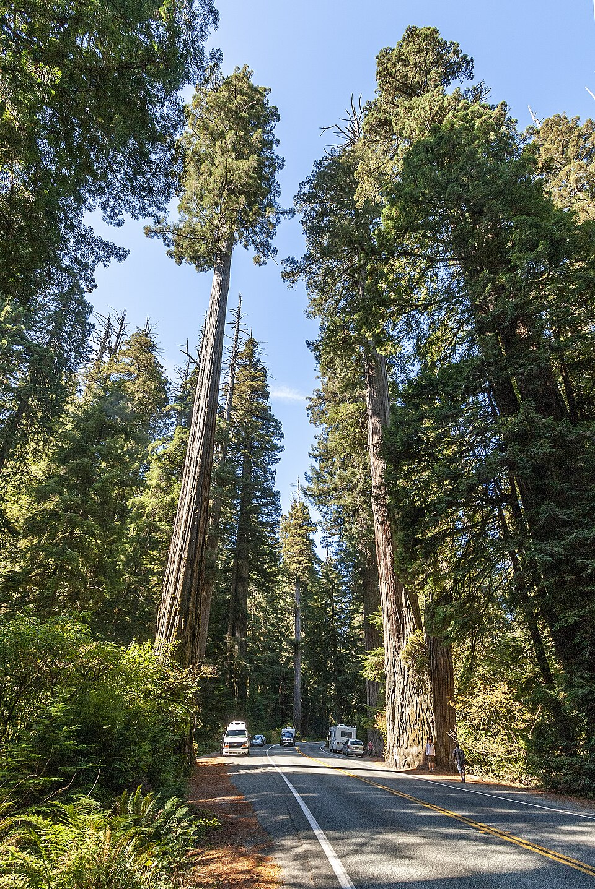
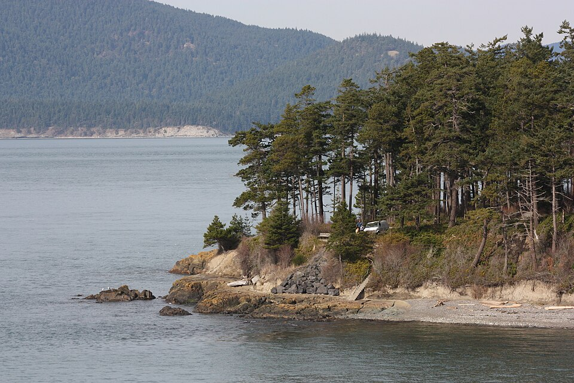

# Oceania & Americas — indicator species

## Tasmanian blue gum (*Eucalyptus globulus*)

{ width=340 }

**Geolocation tell:** Australia native; the eucalyptus planted across Iberia/California/E. Africa

Eucalyptus globulus, commonly known as southern blue gum or blue gum, is a species of flowering plant in the family Myrtaceae. It is a tall, evergreen tree endemic to southeastern Australia. This Eucalyptus species has mostly smooth bark, juvenile leaves that are whitish and waxy on the lower surface, glossy green, lance-shaped adult leaves, glaucous, ribbed flower buds arranged singly or in groups of three or seven in leaf axils, white flowers and woody fruit. *([Wikipedia](https://en.wikipedia.org/wiki/Eucalyptus_globulus), CC BY-SA)*

[**⌖ live distribution map**](/app/index.html#species=3176787&name=Tasmanian%20blue%20gum) · [POWO](https://powo.science.kew.org/results?q=Eucalyptus%20globulus) · [GBIF](https://www.gbif.org/species/3176787)

## Grass tree (*Xanthorrhoea*)

**Geolocation tell:** Black trunk + grass skirt = Australia only

[**⌖ live distribution map**](/app/index.html#species=2779409&name=Grass%20tree) · [POWO](https://powo.science.kew.org/results?q=Xanthorrhoea) · [GBIF](https://www.gbif.org/species/2779409)

## Norfolk Island pine (*Araucaria heterophylla*)

{ width=340 }

**Geolocation tell:** Symmetrical tiers; seafront promenades worldwide, Pacific origin

Araucaria heterophylla is a species of conifer. As its vernacular name Norfolk Island pine implies, the tree is endemic to Norfolk Island, an external territory of Australia located in the Pacific Ocean between New Zealand and New Caledonia. It is not a true pine, which belong to the genus Pinus in the family Pinaceae, but instead is a member of the genus Araucaria in the family Araucariaceae, which also contains the hoop pine and the monkey-puzzle tree. Members of Araucaria occur across the South Pacific, especially concentrated in New Caledonia, where 13 closely related species of similar ap *([Wikipedia](https://en.wikipedia.org/wiki/Araucaria_heterophylla), CC BY-SA)*

[**⌖ live distribution map**](/app/index.html#species=2684969&name=Norfolk%20Island%20pine) · [POWO](https://powo.science.kew.org/results?q=Araucaria%20heterophylla) · [GBIF](https://www.gbif.org/species/2684969)

## Monkey puzzle (*Araucaria araucana*)

**Geolocation tell:** Chile/Argentina Andes — reptilian branches

[**⌖ live distribution map**](/app/index.html#species=2684984&name=Monkey%20puzzle) · [POWO](https://powo.science.kew.org/results?q=Araucaria%20araucana) · [GBIF](https://www.gbif.org/species/2684984)

## Coast redwood (*Sequoia sempervirens*)

{ width=340 }

**Geolocation tell:** N. California fog belt only (wild)

Sequoia sempervirens is the sole living species of the genus Sequoia in the cypress family Cupressaceae. Common names include coast redwood, coastal redwood and California redwood. It is an evergreen, long-lived, monoecious tree living 1,200–2,200 years or more. This species includes the tallest living trees on Earth, reaching up to 116.22 m (381.3 ft) in height and up to 8.9 m (29 ft) in diameter at breast height. These trees are also among the longest-living trees on Earth. Before commercial logging and clearing began by the 1850s, this massive tree occurred naturally in an estimated 810,000 *([Wikipedia](https://en.wikipedia.org/wiki/Sequoia_sempervirens), CC BY-SA)*

[**⌖ live distribution map**](/app/index.html#species=2683909&name=Coast%20redwood) · [POWO](https://powo.science.kew.org/results?q=Sequoia%20sempervirens) · [GBIF](https://www.gbif.org/species/2683909)

## Douglas fir (*Pseudotsuga menziesii*)

{ width=340 }

**Geolocation tell:** Pacific NW giant; plantations in W. Europe/NZ

The Douglas fir is an evergreen conifer species in the pine family, Pinaceae. It is the tallest tree in the Pinaceae family. It is native to western North America and is also known as Douglas-fir, Douglas spruce, Oregon pine, and Columbian pine. There are three varieties: coast Douglas-fir, Rocky Mountain Douglas-fir and Mexican Douglas-fir. *([Wikipedia](https://en.wikipedia.org/wiki/Douglas_fir), CC BY-SA)*

[**⌖ live distribution map**](/app/index.html#species=2685796&name=Douglas%20fir) · [POWO](https://powo.science.kew.org/results?q=Pseudotsuga%20menziesii) · [GBIF](https://www.gbif.org/species/2685796)

## Tree fern (*Cyathea*)

**Geolocation tell:** NZ/SE Australia/tropical highlands understory

[**⌖ live distribution map**](/app/index.html#species=2650273&name=Tree%20fern) · [POWO](https://powo.science.kew.org/results?q=Cyathea) · [GBIF](https://www.gbif.org/species/2650273)

## Pōhutukawa (*Metrosideros excelsa*)

**Geolocation tell:** Red December bloom on N. New Zealand coasts

[**⌖ live distribution map**](/app/index.html#species=3185393&name=P%C5%8Dhutukawa) · [POWO](https://powo.science.kew.org/results?q=Metrosideros%20excelsa) · [GBIF](https://www.gbif.org/species/3185393)
