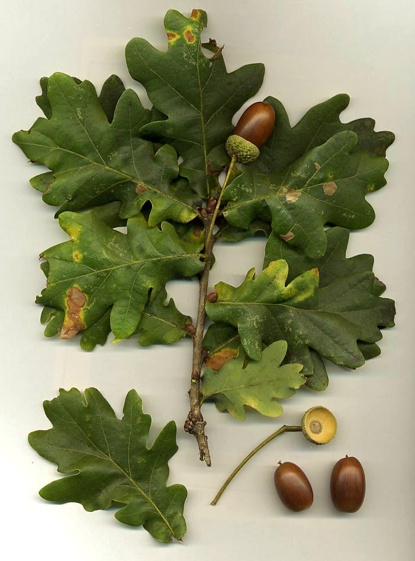
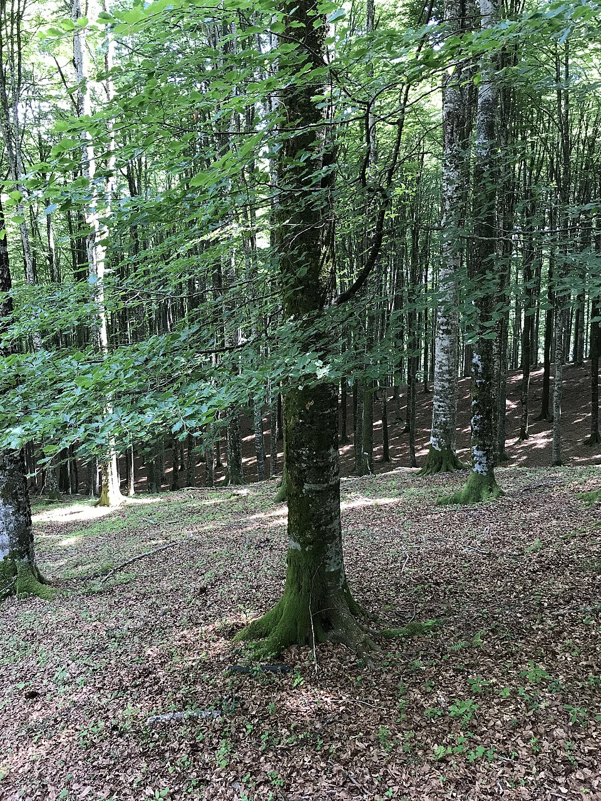
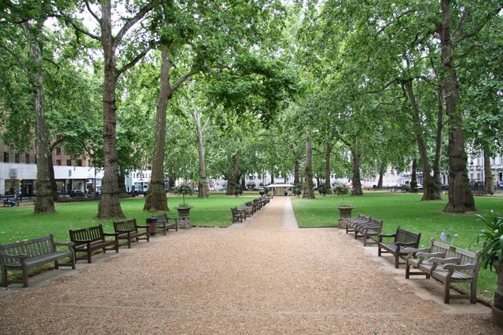
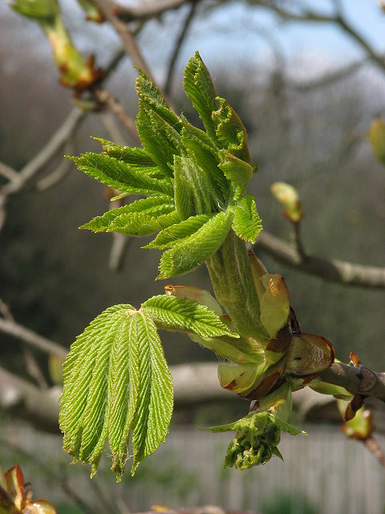
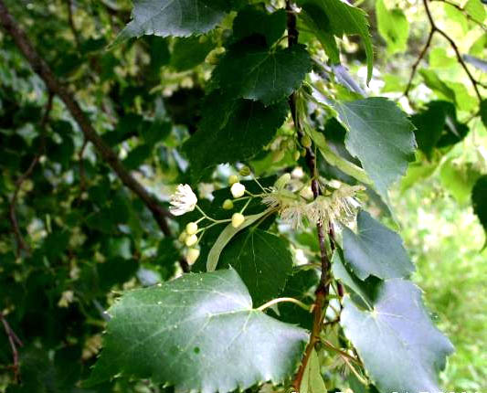
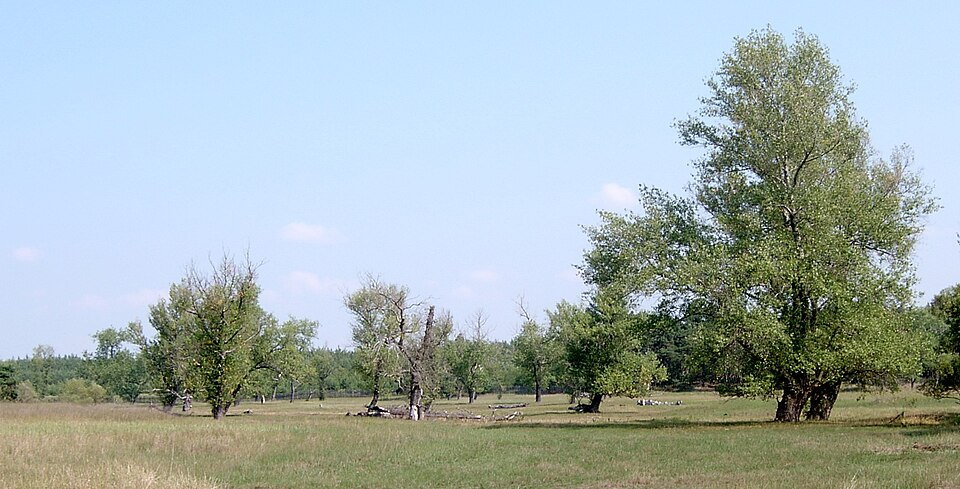

# Temperate — indicator species

**Climate signal:** these species indicate **Köppen Cfb · Cfa · Dfb** — temperate oceanic & humid-continental. See the [Köppen-Geiger map & quick read](/wiki/identify/vegetation-climate/) to place the zone.

## English oak (*Quercus robur*)

{ width=340 }

**Geolocation tell:** Broad solitary field trees in W/C Europe hedgerow landscapes

Quercus robur, pedunculate oak, or English oak, is a species of flowering plant in the beech and oak family, Fagaceae. It is a large tree, native to Europe and western Asia, and is widely cultivated in other temperate regions. It grows on soils of near neutral acidity in the lowlands and is notable for its value to natural ecosystems, supporting a diversity of herbivorous insects, acorn eating mammals and birds, and fungi. *([Wikipedia](https://en.wikipedia.org/wiki/Quercus_robur), CC BY-SA)*

[**⌖ live distribution map**](/app/index.html#species=2878688&name=English%20oak) · [POWO](https://powo.science.kew.org/results?q=Quercus%20robur) · [GBIF](https://www.gbif.org/species/2878688)

## European beech (*Fagus sylvatica*)

{ width=340 }

**Geolocation tell:** Smooth grey bark, dense dark forests (C. Europe)

Fagus sylvatica, the European beech or common beech, is a large deciduous tree in the beech family with smooth silvery-grey bark, large leaf area, and a short trunk with low branches. It is native to much of Europe, growing in humid climates. *([Wikipedia](https://en.wikipedia.org/wiki/Fagus_sylvatica), CC BY-SA)*

[**⌖ live distribution map**](/app/index.html#species=2882316&name=European%20beech) · [POWO](https://powo.science.kew.org/results?q=Fagus%20sylvatica) · [GBIF](https://www.gbif.org/species/2882316)

## London plane (*Platanus × acerifolia*)

{ width=340 }

**Geolocation tell:** Camouflage-flaking bark; THE avenue tree of Paris/London/Madrid

The London plane, or sometimes hybrid plane, Platanus × hispanica, is a tree in the genus Platanus. It is often known by the synonym Platanus × acerifolia, a later name. It is a hybrid of Platanus orientalis and Platanus occidentalis. *([Wikipedia](https://en.wikipedia.org/wiki/London_plane), CC BY-SA)*

[**⌖ live distribution map**](/app/index.html#species=3152815&name=London%20plane) · [POWO](https://powo.science.kew.org/results?q=Platanus%20%C3%97%20acerifolia) · [GBIF](https://www.gbif.org/species/3152815)

## Horse chestnut (*Aesculus hippocastanum*)

{ width=340 }

**Geolocation tell:** Hand-shaped leaves, conkers; C. European parks and beer gardens

Aesculus hippocastanum, the horse chestnut, is a species of flowering plant in the maple, soapberry and lychee family Sapindaceae. It is a large, deciduous, synoecious (hermaphroditic-flowered) tree. It is also called horse-chestnut, European horsechestnut, buckeye, and conker tree. It is not to be confused with the sweet chestnut or Spanish chestnut, Castanea sativa, which is a tree in another family, Fagaceae. *([Wikipedia](https://en.wikipedia.org/wiki/Aesculus_hippocastanum), CC BY-SA)*

[**⌖ live distribution map**](/app/index.html#species=3189815&name=Horse%20chestnut) · [POWO](https://powo.science.kew.org/results?q=Aesculus%20hippocastanum) · [GBIF](https://www.gbif.org/species/3189815)

## Small-leaved lime (*Tilia cordata*)

{ width=340 }

**Geolocation tell:** Pollarded street rows in Germany/CEE (Unter den Linden)

Tilia cordata, the small-leaved lime or small-leaved linden, is a species of tree in the family Malvaceae, native to much of Europe. Its other common names include little-leaf or littleleaf linden, or traditionally in South East England, pry or pry tree. Its range extends from Britain through mainland Europe to the Caucasus and western Asia. In the south of its range it is restricted to high elevations. *([Wikipedia](https://en.wikipedia.org/wiki/Tilia_cordata), CC BY-SA)*

[**⌖ live distribution map**](/app/index.html#species=3152047&name=Small-leaved%20lime) · [POWO](https://powo.science.kew.org/results?q=Tilia%20cordata) · [GBIF](https://www.gbif.org/species/3152047)

## Lombardy poplar (*Populus nigra 'Italica'*)

{ width=340 }

**Geolocation tell:** Pencil-thin windbreak rows: Po valley, France, Argentina's pampa

Populus nigra, the black poplar, is a species of cottonwood poplar, the type species of section Aigeiros of the genus Populus, native to Europe, southwest and central Asia, and northwest Africa. *([Wikipedia](https://en.wikipedia.org/wiki/Populus_nigra), CC BY-SA)*

[**⌖ live distribution map**](/app/index.html#species=3040227&name=Lombardy%20poplar) · [POWO](https://powo.science.kew.org/results?q=Populus%20nigra%20%27Italica%27) · [GBIF](https://www.gbif.org/species/3040227)
