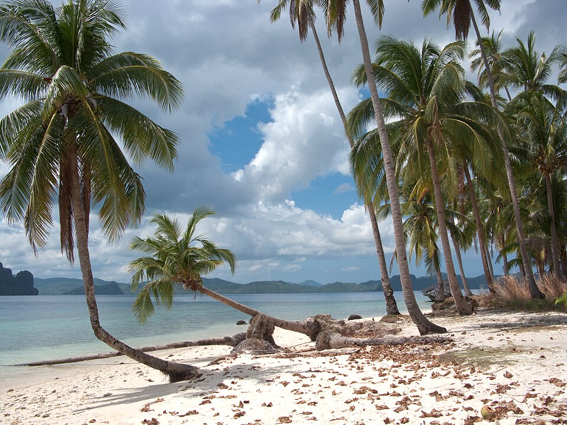
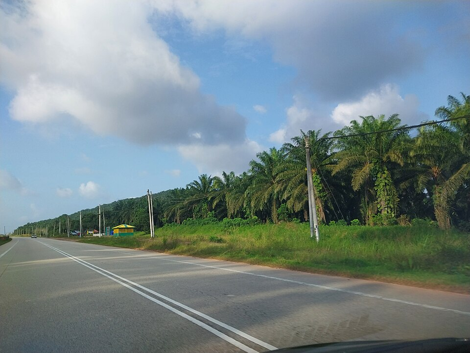
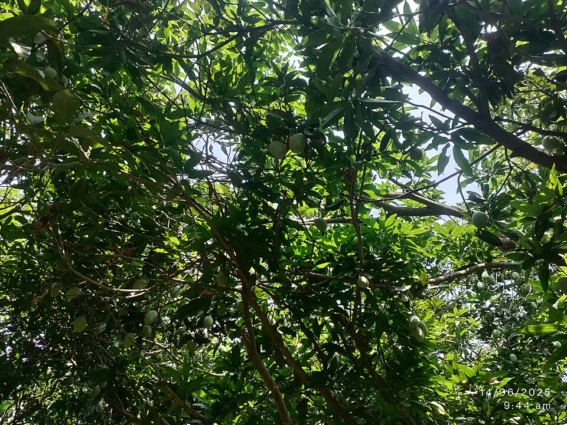
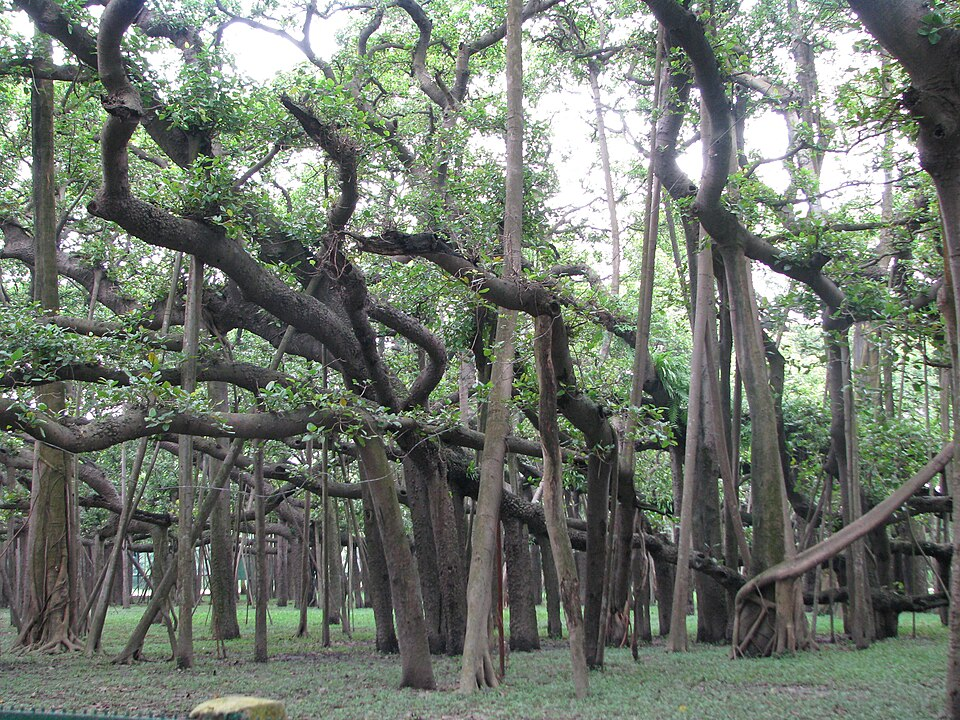
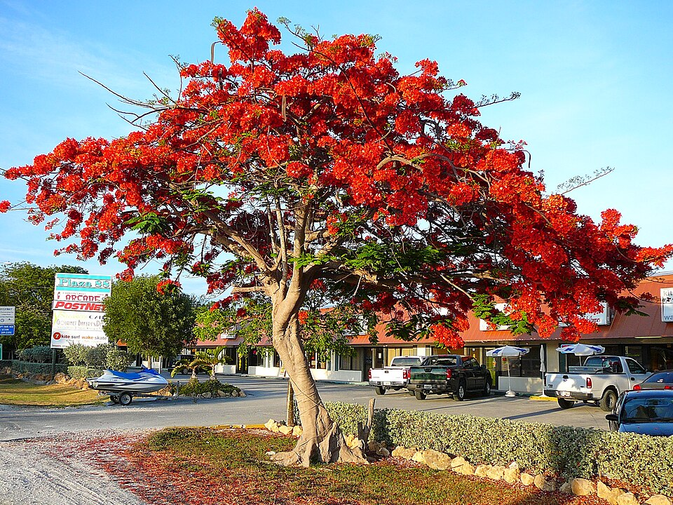
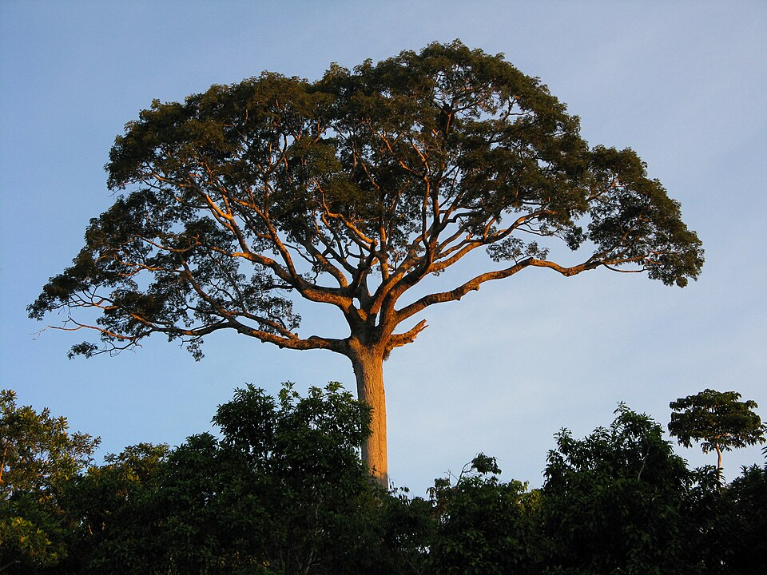
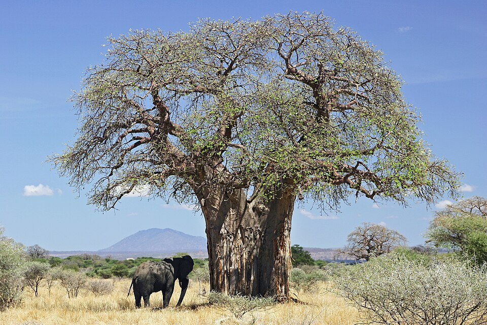
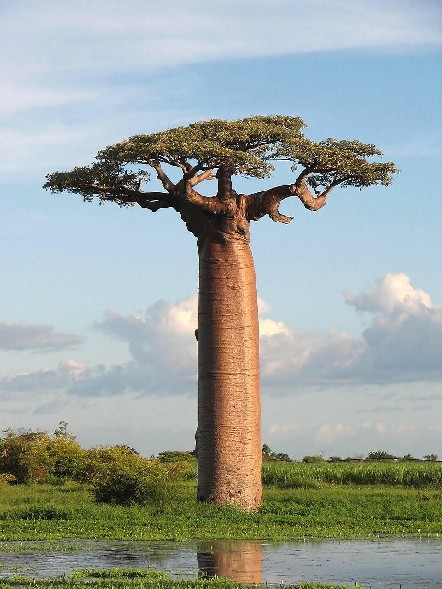
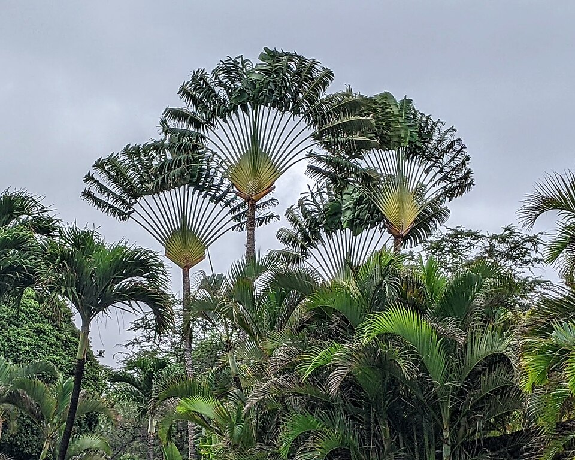

# Tropical — indicator species

## Coconut palm (*Cocos nucifera*)

{ width=340 }

**Geolocation tell:** Leaning over beaches throughout the humid tropics

The coconut is a member of the palm family (Arecaceae) and the only living species of the genus Cocos. The term "coconut" can denote the whole coconut palm tree or the large hard fruit. Originally native to the Central Indo-Pacific, they are ubiquitous in coastal tropical regions. *([Wikipedia](https://en.wikipedia.org/wiki/Coconut), CC BY-SA)*

[**⌖ live distribution map**](/app/index.html#species=2735117&name=Coconut%20palm) · [POWO](https://powo.science.kew.org/results?q=Cocos%20nucifera) · [GBIF](https://www.gbif.org/species/2735117)

## Oil palm (*Elaeis guineensis*)

{ width=340 }

**Geolocation tell:** Plantation grids = Malaysia/Indonesia/W. Africa; NOT a wild beach palm

Elaeis guineensis is a species of palm commonly called oil palm but also sometimes African oil palm or macaw-fat. The first Western person to describe it and bring back seeds was the French naturalist Michel Adanson. *([Wikipedia](https://en.wikipedia.org/wiki/Elaeis_guineensis), CC BY-SA)*

[**⌖ live distribution map**](/app/index.html#species=2731882&name=Oil%20palm) · [POWO](https://powo.science.kew.org/results?q=Elaeis%20guineensis) · [GBIF](https://www.gbif.org/species/2731882)

## Banana/plantain (*Musa × paradisiaca*)

{ width=340 }

**Geolocation tell:** Smallholder clumps across all humid tropics

A banana is an elongated, edible fruit that is botanically a berry produced by several kinds of large treelike herbaceous flowering plants in the genus Musa. In some countries, cooking bananas are called plantains, distinguishing them from dessert bananas. The fruit is variable in size, color and firmness, but is usually elongated and curved, with soft flesh rich in starch covered with a peel, which may have a variety of colors when ripe. It grows upward in clusters near the top of the plant. Almost all modern edible seedless (parthenocarp) cultivated bananas come from two wild species – Musa  *([Wikipedia](https://en.wikipedia.org/wiki/Banana), CC BY-SA)*

[**⌖ live distribution map**](/app/index.html#species=2762752&name=Banana/plantain) · [POWO](https://powo.science.kew.org/results?q=Musa%20%C3%97%20paradisiaca) · [GBIF](https://www.gbif.org/species/2762752)

## Mango (*Mangifera indica*)

{ width=340 }

**Geolocation tell:** Huge dark-domed village shade tree: S/SE Asia, Africa, LatAm

Mangifera indica, commonly known as the mango after its fruit, is an evergreen species of flowering plant in the family Anacardiaceae. It is a large fruit tree, capable of growing to a height and width of 30 m (100 ft). There are two distinct genetic populations in modern mangoes – the "Indian type" and the "Southeast Asian type". *([Wikipedia](https://en.wikipedia.org/wiki/Mangifera_indica), CC BY-SA)*

[**⌖ live distribution map**](/app/index.html#species=3190638&name=Mango) · [POWO](https://powo.science.kew.org/results?q=Mangifera%20indica) · [GBIF](https://www.gbif.org/species/3190638)

## Banyan (*Ficus benghalensis*)

{ width=340 }

**Geolocation tell:** Aerial-root curtains; S/SE Asia temple and roadside tree

Ficus benghalensis, Ficus indica, or Ficus audrey commonly known as banyan, banyan fig, audrey fig and Indian banyan, is a tree native to the Indian subcontinent. Specimens in India are among the largest trees in the world by canopy coverage. It is also known as a "strangler fig" because like many other trees in the genus Ficus it starts out as epiphyte, that is, leaning on another tree that it ends up enveloping. *([Wikipedia](https://en.wikipedia.org/wiki/Ficus_benghalensis), CC BY-SA)*

[**⌖ live distribution map**](/app/index.html#species=5361919&name=Banyan) · [POWO](https://powo.science.kew.org/results?q=Ficus%20benghalensis) · [GBIF](https://www.gbif.org/species/5361919)

## Royal poinciana (*Delonix regia*)

{ width=340 }

**Geolocation tell:** Scarlet flowering canopy; planted throughout the tropics

Delonix regia is a species of flowering plant in the bean family Fabaceae, subfamily Caesalpinioideae native to Madagascar. It is noted for its fern-like leaves and flamboyant display of orange-red flowers over summer. In many tropical parts of the world it is grown as an ornamental tree. It is a non-nodulating legume. *([Wikipedia](https://en.wikipedia.org/wiki/Delonix_regia), CC BY-SA)*

[**⌖ live distribution map**](/app/index.html#species=2956176&name=Royal%20poinciana) · [POWO](https://powo.science.kew.org/results?q=Delonix%20regia) · [GBIF](https://www.gbif.org/species/2956176)

## Kapok (*Ceiba pentandra*)

{ width=340 }

**Geolocation tell:** Massive buttressed emergent of neotropical/W. African forests

Ceiba pentandra is a tropical tree of the order Malvales and the family Malvaceae, native to Central America, the Caribbean, and the northern half of South America; some authors also consider it native in western and central Africa. It is widely introduced in other tropical regions including South and Southeast Asia, where it is cultivated. *([Wikipedia](https://en.wikipedia.org/wiki/Ceiba_pentandra), CC BY-SA)*

[**⌖ live distribution map**](/app/index.html#species=5406697&name=Kapok) · [POWO](https://powo.science.kew.org/results?q=Ceiba%20pentandra) · [GBIF](https://www.gbif.org/species/5406697)

## African baobab (*Adansonia digitata*)

{ width=340 }

**Geolocation tell:** Sub-Saharan savanna icon; bottle trunk

Adansonia digitata, the African baobab, is the most widespread tree species of the genus Adansonia, the baobabs, and is native to the African continent and the southern Arabian Peninsula. These are long-lived pachycauls; radiocarbon dating has shown at least one individual to be 1,275 years old. They are typically found in dry, hot savannas of sub-Saharan Africa, where they dominate the landscape and reveal the presence of a watercourse from afar. They have traditionally been valued as sources of food, water, health remedies or places of shelter and are a key food source for many animals. They *([Wikipedia](https://en.wikipedia.org/wiki/Adansonia_digitata), CC BY-SA)*

[**⌖ live distribution map**](/app/index.html#species=5406695&name=African%20baobab) · [POWO](https://powo.science.kew.org/results?q=Adansonia%20digitata) · [GBIF](https://www.gbif.org/species/5406695)

## Grandidier's baobab (*Adansonia grandidieri*)

{ width=340 }

**Geolocation tell:** Madagascar only — Avenue of the Baobabs

Adansonia grandidieri is the biggest and most famous of Madagascar's six species of baobabs. It is sometimes known as Grandidier's baobab or the giant baobab. In French it is called Baobab malgache. The local name is renala or reniala. This tree is endemic to the island of Madagascar, where it is an endangered species threatened by the encroachment of agricultural land. This is the tree found at the Avenue of the Baobabs. *([Wikipedia](https://en.wikipedia.org/wiki/Adansonia_grandidieri), CC BY-SA)*

[**⌖ live distribution map**](/app/index.html#species=5663154&name=Grandidier%27s%20baobab) · [POWO](https://powo.science.kew.org/results?q=Adansonia%20grandidieri) · [GBIF](https://www.gbif.org/species/5663154)

## Traveller's palm (*Ravenala madagascariensis*)

{ width=340 }

**Geolocation tell:** Fan-plane of leaves; Madagascar native, tropical hotel landmark

Ravenala is a genus of monocotyledonous flowering plants in the Strelitziaceae plant family. Classically, the genus was considered to include a single species, Ravenala madagascariensis from Madagascar. *([Wikipedia](https://en.wikipedia.org/wiki/Ravenala), CC BY-SA)*

[**⌖ live distribution map**](/app/index.html#species=2763095&name=Traveller%27s%20palm) · [POWO](https://powo.science.kew.org/results?q=Ravenala%20madagascariensis) · [GBIF](https://www.gbif.org/species/2763095)
