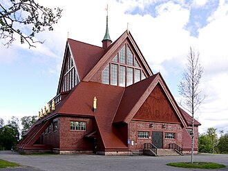
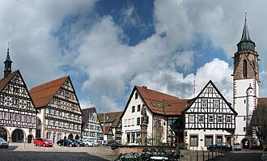
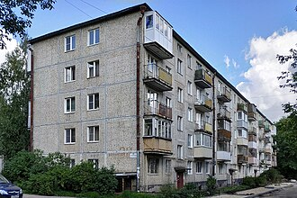
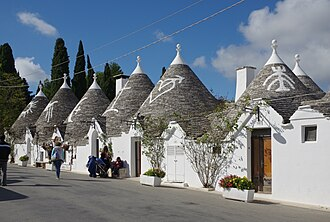
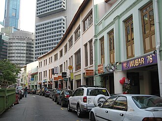
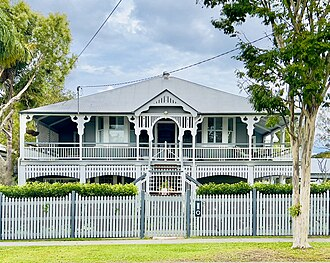

# Architecture by region

Buildings are slow-changing, standard-driven, and visible in every photo — read the **roof,
wall material and window pattern** first. Visual references: the **Photo gallery
at the bottom of this page** (67 photos by continent) and the cited literature.

## Visual reference (Wikimedia Commons, free licenses)

| | | |
|---|---|---|
|  |  |  |
| Falu-red timber (Sweden) — [source](https://commons.wikimedia.org/wiki/File:Kiruna_kyrka_main_view.jpg) | Fachwerk (Germany) — [source](https://commons.wikimedia.org/wiki/File:Dornstetten-p01_crop.JPG) | Khrushchyovka (ex-USSR) — [source](https://commons.wikimedia.org/wiki/File:%D0%93%D0%B0%D1%82%D1%87%D0%B8%D0%BD%D0%B0._%D0%A3%D0%BB%D0%B8%D1%86%D0%B0_%D0%92%D0%BE%D0%BB%D0%BE%D0%B4%D0%B0%D1%80%D1%81%D0%BA%D0%BE%D0%B3%D0%BE%2C_28.jpg) |
|  |  |  |
| Trulli (Puglia, IT) — [source](https://commons.wikimedia.org/wiki/File:Alberobello_BW_2016-10-16_13-43-03.jpg) | Shophouses (SE Asia) — [source](https://commons.wikimedia.org/wiki/File:Circular_Road_3.JPG) | Queenslander (AU) — [source](https://commons.wikimedia.org/wiki/File:Queenslander_style_house_in_Sherwood,_Queensland,_2022,_03.jpg) |

## Europe

| Signature | Region | Notes |
|---|---|---|
| Terracotta barrel-tile roofs, stucco walls (white/ochre) | Mediterranean (ES, IT, PT, GR, S. FR, Balkans coast) | Roman/Spanish tile tradition[^medit] |
| Falu-red wooden houses, white trim | Sweden, Finland, Norway | Falu red paint from the Falun mine — documented Swedish tradition[^falu] |
| Dark half-timbering (Fachwerk/colombage) | Germany, Alsace, N. France, England (Tudor) | [^fachwerk] |
| Brick terraces, sash windows, chimney rows | UK, Ireland | Victorian/Edwardian housing stock[^uk-terrace] |
| Tall narrow gabled brick facades on canals | Netherlands, Flanders | Dutch canal-house typology[^dutch] |
| Large concrete **panel apartment blocks** (panelák / khrushchyovka / Plattenbau) | Entire ex-socialist bloc: Russia, Ukraine, CEE, Baltics, Balkans | Soviet standardized series (K-7 etc.)[^panel] |
| Alpine chalets: wide low-pitch roofs, deep eaves, wooden balconies | Switzerland, Austria, Bavaria, alpine FR/IT | [^chalet] |
| Trulli / whitewashed cubic villages | Puglia (IT) / Cyclades (GR) | Hyper-local — instant region IDs |

## Americas

- **US/Canada suburbs**: detached timber-frame houses with **vinyl/clapboard siding**,
  asphalt-shingle roofs, attached garages; near-absent elsewhere on Earth at this scale.[^us-housing]
- **Latin America**: unrendered **concrete-block + rebar stubs** on flat roofs (incremental
  construction), painted shopfront ads; Spanish-colonial grid towns with central plaza +
  church.[^latam]
- **Mexico/Andes**: brightly painted render; **Brazil**: exposed red ceramic block.

## Asia, Africa & Oceania

- **Japan**: compact houses with grey glazed/concrete tile roofs, neat utility runs; shallow
  street setbacks.[^japan-house]
- **SE Asia shophouse**: 2–3-storey row houses, shop below, living above (Singapore, Malaysia,
  Thailand, Vietnam, Indonesia).[^shophouse]
- **China**: white-tile cladding boom-era blocks; massive xiaoqu gated estates.
- **South Asia**: flat concrete roofs with water tanks (black Sintex tanks in India), brick
  with painted political/movie ads.
- **Middle East/N. Africa**: flat roofs, sand-coloured render, parapet walls, rooftop satellite
  forests; AC units on every facade.
- **Sub-Saharan Africa**: corrugated-iron roofing dominant (silver/red); mud-brick in Sahel;
  South Africa's distinctive RDP grid housing.[^africa-roof]
- **Australia**: single-storey brick-veneer with corrugated "Colorbond" steel roofs;
  Queenslander stilt houses in QLD.[^queenslander]

[^medit]: Oliver, P. (ed.), *Encyclopedia of Vernacular Architecture of the World*, CUP 1997 — Mediterranean tile traditions.
[^falu]: Swedish National Heritage Board (Riksantikvarieämbetet) on [Falu rödfärg tradition](https://www.raa.se/); Falun mine UNESCO listing.
[^fachwerk]: Deutsche Fachwerkstraße documentation, [fachwerkstrasse.de](https://www.deutsche-fachwerkstrasse.de/).
[^uk-terrace]: Historic England, [The English terraced house research](https://historicengland.org.uk/).
[^dutch]: Amsterdam City Archives / UNESCO, [Canal ring nomination file](https://whc.unesco.org/en/list/1349/).
[^panel]: Meuser & Zadorin, *Towards a Typology of Soviet Mass Housing* (DOM Publishers, 2015) — the standard reference for series identification.
[^chalet]: Oliver, *EVAW* (above), Alpine chapter.
[^us-housing]: US Census Bureau, [Characteristics of New Housing](https://www.census.gov/construction/chars/) — materials statistics.
[^latam]: Gilbert, A., *The Latin American City*, LAB 1998 — incremental self-build construction.
[^japan-house]: Nishi & Hozumi, *What is Japanese Architecture?*, Kodansha.
[^shophouse]: Singapore URA, [Shophouse conservation guidelines](https://www.ura.gov.sg/Corporate/Guidelines/Conservation).
[^africa-roof]: World Bank housing surveys.
[^queenslander]: Queensland Government heritage register, [The Queenslander house](https://www.qld.gov.au/environment/land/heritage).

<!-- GEOHINTS:architecture START -->

## Photo gallery — Architecture

### Africa

<figure><figcaption>Lesotho · <a href="https://goo.gl/maps/NVZAjf73ckrVQa3B9" target="_blank">map</a></figcaption></figure>
<figure><figcaption>Lesotho · <a href="https://goo.gl/maps/Szqh8mfdbDtaEzCN8" target="_blank">map</a></figcaption></figure>
<figure><figcaption>Tunisia · <a href="https://goo.gl/maps/VGwNBbgCPKwvba4P9" target="_blank">map</a></figcaption></figure>
<figure><figcaption>Tunisia · <a href="https://goo.gl/maps/ANLV7bx5DoEV1p5BA" target="_blank">map</a></figcaption></figure>

### Asia

<figure><figcaption>Bhutan · <a href="https://goo.gl/maps/T1NCDa2mNYZDEVtg6" target="_blank">map</a></figcaption></figure>
<figure><figcaption>Cambodia · <a href="https://goo.gl/maps/KJCRUSxKypvVwv9w9" target="_blank">map</a></figcaption></figure>
<figure><figcaption>Japan · <a href="https://goo.gl/maps/MPtHxNzUor7WTcU47" target="_blank">map</a></figcaption></figure>
<figure><figcaption>Kyrgyzstan · <a href="https://goo.gl/maps/XRaXSs8nHQCBpq7f8" target="_blank">map</a></figcaption></figure>
<figure><figcaption>Lebanon · <a href="https://maps.app.goo.gl/7Eqe5vrxeCdnumz99" target="_blank">map</a></figcaption></figure>
<figure><figcaption>Malaysia · <a href="https://goo.gl/maps/XeByjMVQ2XpZp6JW7" target="_blank">map</a></figcaption></figure>
<figure><figcaption>Mongolia · <a href="https://goo.gl/maps/CMtuzxPWQaRyj24g9" target="_blank">map</a></figcaption></figure>
<figure><figcaption>Mongolia · <a href="https://goo.gl/maps/vruke52YTbAGTUqR7" target="_blank">map</a></figcaption></figure>
<figure><figcaption>Singapore · <a href="https://goo.gl/maps/DPscfY5LHTJ5ziqu9" target="_blank">map</a></figcaption></figure>
<figure><figcaption>South Korea · <a href="https://goo.gl/maps/6YgHuVoimrT3453Q8" target="_blank">map</a></figcaption></figure>
<figure><figcaption>Taiwan · <a href="https://goo.gl/maps/PYTnA9gZHfzY9Tic9" target="_blank">map</a></figcaption></figure>

### Europe

<figure><figcaption>Andorra · <a href="https://goo.gl/maps/cL6wfAEyf5fZoGkd9" target="_blank">map</a></figcaption></figure>
<figure><figcaption>Andorra · <a href="https://goo.gl/maps/TwYrVRd5bdiKGq3v7" target="_blank">map</a></figcaption></figure>
<figure><figcaption>Austria · <a href="https://goo.gl/maps/xs7Ccmaa3jYxTqdYA" target="_blank">map</a></figcaption></figure>
<figure><figcaption>Austria · <a href="https://goo.gl/maps/ezGSJHYHryyL4hwo6" target="_blank">map</a></figcaption></figure>
<figure><figcaption>Austria · <a href="https://goo.gl/maps/GvMw5Vs8zfXPEhxN9" target="_blank">map</a></figcaption></figure>
<figure><figcaption>Austria · <a href="https://maps.app.goo.gl/JXZpsEzQ6gdqTHHy5" target="_blank">map</a></figcaption></figure>
<figure><figcaption>Austria · <a href="https://maps.app.goo.gl/smzYTcNfnNrfQVx76" target="_blank">map</a></figcaption></figure>
<figure><figcaption>Belgium · <a href="https://goo.gl/maps/tWsbUvHJcNFDv86H8" target="_blank">map</a></figcaption></figure>
<figure><figcaption>Bulgaria · <a href="https://goo.gl/maps/koGNDWfPgdskhZkWA" target="_blank">map</a></figcaption></figure>
<figure><figcaption>Denmark · <a href="https://goo.gl/maps/NSLRScjAQj6eY31H9" target="_blank">map</a></figcaption></figure>
<figure><figcaption>Faroe Islands · <a href="https://goo.gl/maps/9JwsNRc1vjpmbxkG6" target="_blank">map</a></figcaption></figure>
<figure><figcaption>Faroe Islands · <a href="https://goo.gl/maps/SUchVyW946WH4JMH8" target="_blank">map</a></figcaption></figure>
<figure><figcaption>Finland · <a href="https://goo.gl/maps/RTujVbqzLKDAaLKN7" target="_blank">map</a></figcaption></figure>
<figure><figcaption>France · <a href="https://goo.gl/maps/W3QiBQpacd8U5SsVA" target="_blank">map</a></figcaption></figure>
<figure><figcaption>France · <a href="https://goo.gl/maps/kDmWnytL8MHY9WLv9" target="_blank">map</a></figcaption></figure>
<figure><figcaption>France · <a href="https://goo.gl/maps/1f9ncUjq1NsvjLFz9" target="_blank">map</a></figcaption></figure>
<figure><figcaption>France · <a href="https://maps.app.goo.gl/8PiCgshwvDA23bXw9" target="_blank">map</a></figcaption></figure>
<figure><figcaption>Hungary · <a href="https://goo.gl/maps/QAjN8oYGKbewz6s36" target="_blank">map</a></figcaption></figure>
<figure><figcaption>Malta · <a href="https://goo.gl/maps/irJpBwDx81aAbAp58" target="_blank">map</a></figcaption></figure>
<figure><figcaption>Monaco · <a href="https://maps.app.goo.gl/pCvd6JdyGhft662R6" target="_blank">map</a></figcaption></figure>
<figure><figcaption>Netherlands · <a href="https://goo.gl/maps/VAo52gDRwKoV2FEC8" target="_blank">map</a></figcaption></figure>
<figure><figcaption>Netherlands · <a href="https://goo.gl/maps/3upnFjLANRwhaSMY6" target="_blank">map</a></figcaption></figure>
<figure><figcaption>Poland · <a href="https://goo.gl/maps/mq4nN29R4otMqCig8" target="_blank">map</a></figcaption></figure>
<figure><figcaption>Poland · <a href="https://goo.gl/maps/f8L7Bc3rkYWJKKKE9" target="_blank">map</a></figcaption></figure>
<figure><figcaption>Poland · <a href="https://goo.gl/maps/n4Ky4juzR78aPkky9" target="_blank">map</a></figcaption></figure>
<figure><figcaption>Romania · <a href="https://maps.app.goo.gl/x5Xhbwb2QjZUSDxQ8" target="_blank">map</a></figcaption></figure>
<figure><figcaption>Slovakia · <a href="https://goo.gl/maps/HxDr5PGaRbt3fppA8" target="_blank">map</a></figcaption></figure>
<figure><figcaption>Slovenia · <a href="https://goo.gl/maps/o57YzMxianptmSfv8" target="_blank">map</a></figcaption></figure>
<figure><figcaption>Slovenia · <a href="https://goo.gl/maps/ELjch6wNYmtLFocC8" target="_blank">map</a></figcaption></figure>
<figure><figcaption>Slovenia · <a href="https://maps.app.goo.gl/DMWELsDefQkDWbMB8" target="_blank">map</a></figcaption></figure>
<figure><figcaption>Slovenia · <a href="https://goo.gl/maps/uwSAQ3c9q1gHRxKfA" target="_blank">map</a></figcaption></figure>
<figure><figcaption>Sweden · <a href="https://goo.gl/maps/tHS5r78weQjj9FMZA" target="_blank">map</a></figcaption></figure>
<figure><figcaption>Switzerland · <a href="https://goo.gl/maps/8qhJeoiJ5bAcm97SA" target="_blank">map</a></figcaption></figure>
<figure><figcaption>Switzerland · <a href="https://goo.gl/maps/ScwqsLLMhwswdqSNA" target="_blank">map</a></figcaption></figure>
<figure><figcaption>United Kingdom · <a href="https://goo.gl/maps/i3coGT4YeQf1NE1v7" target="_blank">map</a></figcaption></figure>
<figure><figcaption>United Kingdom · <a href="https://goo.gl/maps/eKc16EJq41959CG77" target="_blank">map</a></figcaption></figure>
<figure><figcaption>United Kingdom · <a href="https://goo.gl/maps/VG5RUcD3uKry4V4DA" target="_blank">map</a></figcaption></figure>

### North America

<figure><figcaption>Canada · <a href="https://maps.app.goo.gl/s3PfwrKVfhcrYwbk8" target="_blank">map</a></figcaption></figure>
<figure><figcaption>Canada · <a href="https://goo.gl/maps/AZTavwafUN71s1KY8" target="_blank">map</a></figcaption></figure>
<figure><figcaption>Greenland · <a href="https://goo.gl/maps/rro7VgNC68T5Couu8" target="_blank">map</a></figcaption></figure>
<figure><figcaption>Guatemala · <a href="https://maps.app.goo.gl/b7sXmLSVnbEdYMVD7" target="_blank">map</a></figcaption></figure>
<figure><figcaption>United States · <a href="https://goo.gl/maps/9DxPxNXAmv7nbACu9" target="_blank">map</a></figcaption></figure>
<figure><figcaption>United States · <a href="https://goo.gl/maps/UwzQHkpndP7eoDvy7" target="_blank">map</a></figcaption></figure>
<figure><figcaption>United States · <a href="https://maps.app.goo.gl/SZm48uacBoDTsrnv6" target="_blank">map</a></figcaption></figure>

### Oceania

<figure><figcaption>American Samoa · <a href="https://goo.gl/maps/hz6ibto1d8sLojnE7" target="_blank">map</a></figcaption></figure>
<figure><figcaption>American Samoa · <a href="https://goo.gl/maps/EJfFsjrd6RUMfcTm8" target="_blank">map</a></figcaption></figure>
<figure><figcaption>Australia · <a href="https://goo.gl/maps/d3gBNbLBnHaRaPpY9" target="_blank">map</a></figcaption></figure>
<figure><figcaption>Australia · <a href="https://goo.gl/maps/5zpuBYKdHnPdnMH18" target="_blank">map</a></figcaption></figure>
<figure><figcaption>Australia · <a href="https://goo.gl/maps/Pc9SLke2AJX6Mxmy6" target="_blank">map</a></figcaption></figure>
<figure><figcaption>Australia · <a href="https://maps.app.goo.gl/96C9VQz2imXLHMpK9" target="_blank">map</a></figcaption></figure>
<figure><figcaption>Australia · <a href="https://goo.gl/maps/3SygP59LqZoBVTik8" target="_blank">map</a></figcaption></figure>

### South America

<figure><figcaption>Bolivia · <a href="https://goo.gl/maps/YNig7xKaWvsxfoWq8" target="_blank">map</a></figcaption></figure>

*Images load directly from their source in your browser and are not stored in this wiki. Street imagery (c) Google. Requires internet to display.*

<!-- GEOHINTS:architecture END -->
