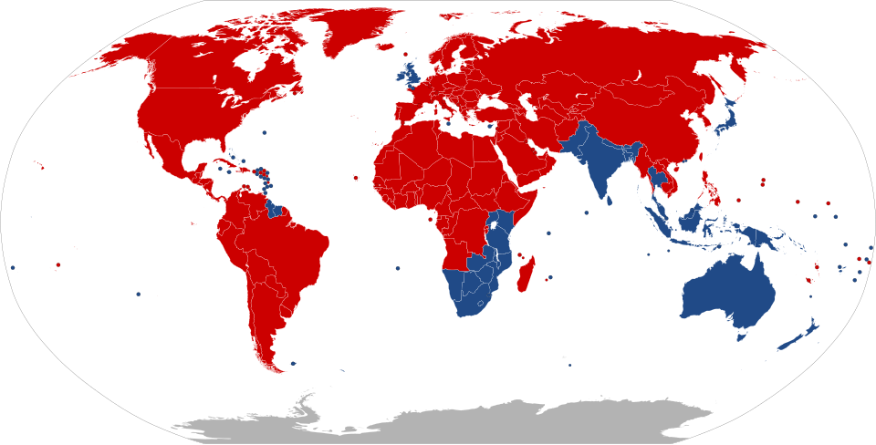

# Driving side

The fastest elimination filter in existence: one glance at traffic, parked cars, or which
side of the road signs face removes a third to two-thirds of all countries.

About **76 countries and territories drive on the left** (~30 % of world population, ~25 % of
roads); the rest drive on the right.[^wiki-lht]

*Blue = drives left, red = drives right ([Wikimedia Commons](https://commons.wikimedia.org/wiki/File:Countries_driving_on_the_left_or_right.svg), CC BY-SA).*

## Left-hand traffic (drive left, steering wheel right)

| Region | Countries |
|---|---|
| Europe | **United Kingdom, Ireland, Malta, Cyprus** (the only four) |
| Asia | Japan, Thailand, Indonesia, Malaysia, Singapore, Brunei, India, Pakistan, Bangladesh, Sri Lanka, Nepal, Bhutan, Hong Kong, Macau, Timor-Leste |
| Africa | South Africa, Namibia, Botswana, Zimbabwe, Zambia, Malawi, Mozambique, Tanzania, Kenya, Uganda, Lesotho, Eswatini, Mauritius, Seychelles |
| Americas | Guyana, Suriname, Jamaica, Barbados, Trinidad & Tobago, Bahamas, and most Caribbean islands |
| Oceania | Australia, New Zealand, Papua New Guinea, Fiji, Samoa, Tonga, Solomon Is., Kiribati |

Everything else — all of continental Europe, Russia/CIS, China, Korea, the Middle East,
nearly all of Africa's west/north, and all of mainland North/Central/South America — drives
**right**.[^worldstandards]

## Traps & history

- **Japan, Thailand, Indonesia** drive left without being former British colonies.
- **Samoa switched right→left in 2009** (to import cheap AUS/NZ cars).[^samoa]
- **Sweden switched left→right in 1967** ("Dagen H") — relevant only for dating archive photos.[^dagenh]
- **Myanmar drives right but most cars have right-hand steering** (imported from Japan) — a
  famous one-country tell.[^myanmar]
- US Virgin Islands: drives **left** with left-hand-drive American cars.

## Reading it from a photo

1. Parked cars' orientation relative to shops.
2. Which lane traffic occupies approaching the camera.
3. Sign backs: you mostly see the **backs** of signs on your own side of the road.
4. Bus stops / bus door side.
5. Road-marking arrows at junctions.

[^wiki-lht]: Wikipedia, [Left- and right-hand traffic](https://en.wikipedia.org/wiki/Left-_and_right-hand_traffic) — maintained country table with legal references.
[^worldstandards]: WorldStandards.eu, [Driving on the left or right](https://www.worldstandards.eu/cars/list-of-left-driving-countries/) — full country list.
[^samoa]: BBC News (7 Sep 2009), [Samoa switches to driving on left](http://news.bbc.co.uk/2/hi/asia-pacific/8240992.stm).
[^dagenh]: Wikipedia, [Dagen H](https://en.wikipedia.org/wiki/Dagen_H).
[^myanmar]: The Straits Times / Nikkei coverage of Myanmar's 2017 RHD import restrictions; summarized in Wikipedia, [Driving in Myanmar](https://en.wikipedia.org/wiki/Left-_and_right-hand_traffic#Myanmar).
