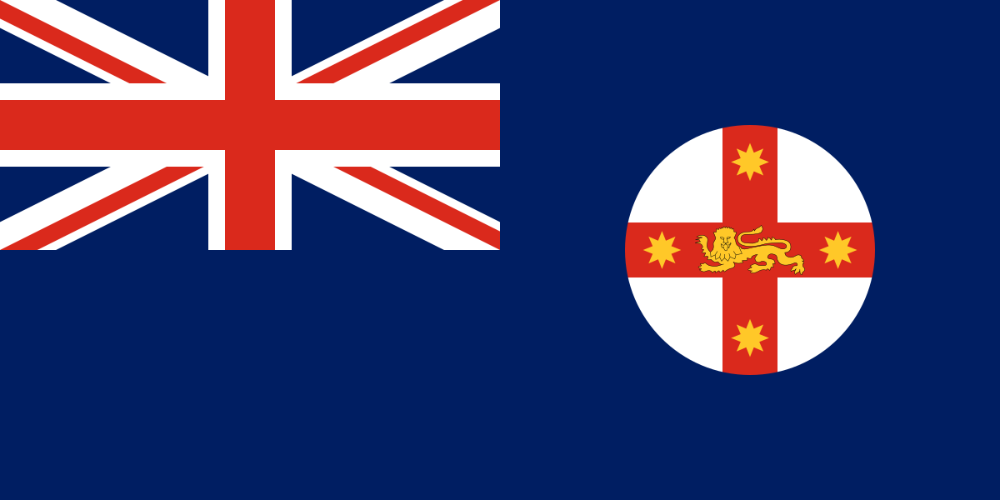
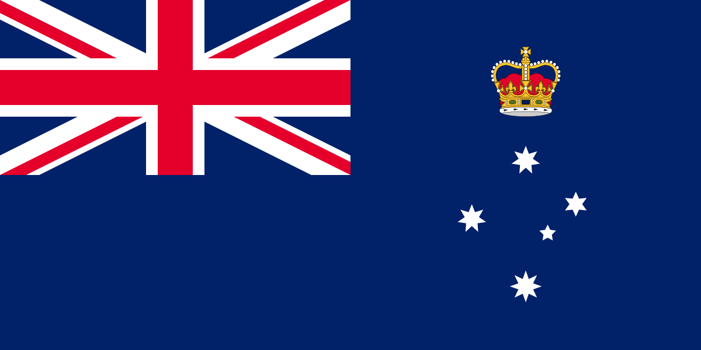
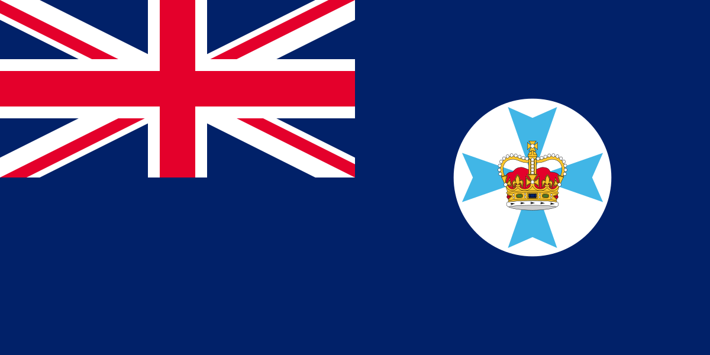
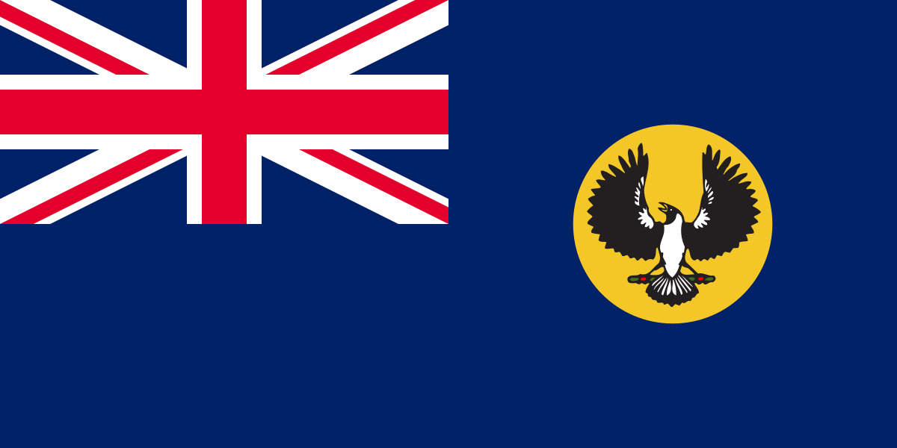
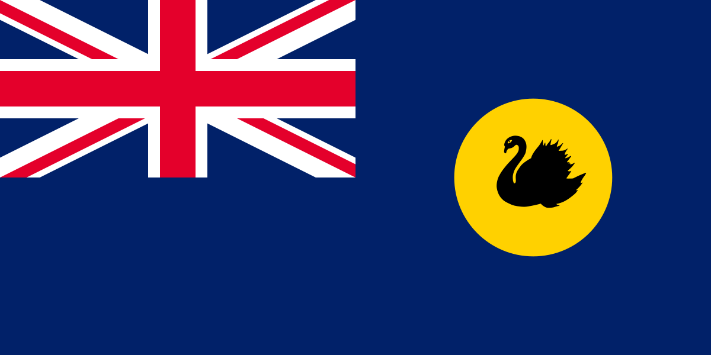
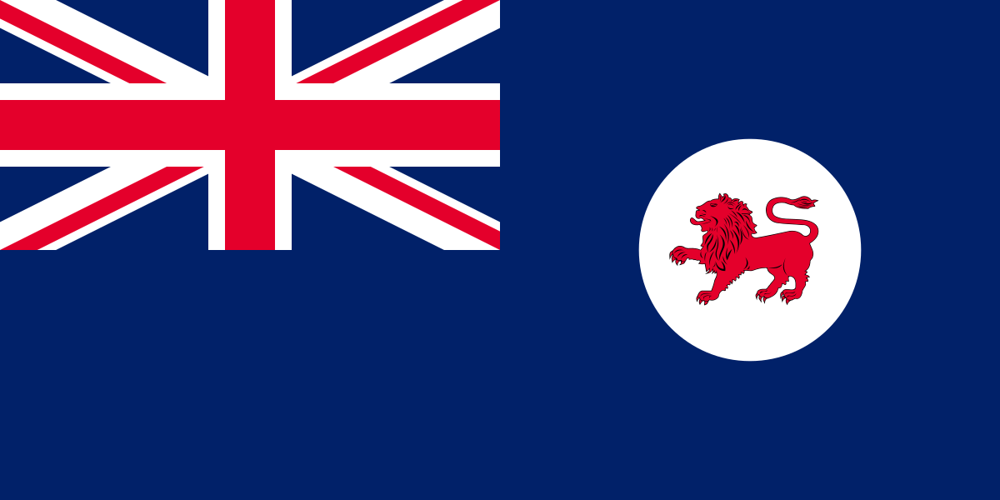
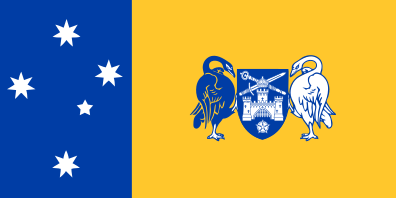
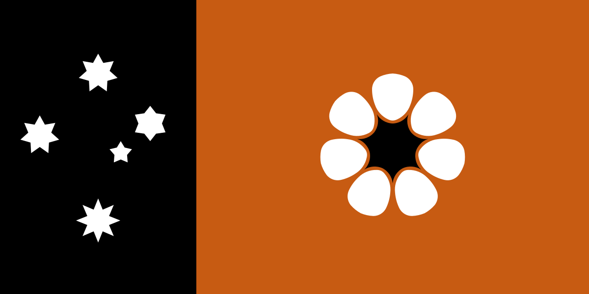

# States & territories of Australia

Subnational flags pin a photo *inside* Australia. **Flag-only reference** for now — names + flags, resolved via each subject's Wikidata flag (P41) and cached locally from [Wikimedia Commons](https://commons.wikimedia.org/). May be expanded with recognition notes later.

<figure><figcaption>New South Wales</figcaption></figure>
<figure><figcaption>Victoria</figcaption></figure>
<figure><figcaption>Queensland</figcaption></figure>
<figure><figcaption>South Australia</figcaption></figure>
<figure><figcaption>Western Australia</figcaption></figure>
<figure><figcaption>Tasmania</figcaption></figure>
<figure><figcaption>Australian Capital Territory</figcaption></figure>
<figure><figcaption>Northern Territory</figcaption></figure>

