# Notable dependencies & autonomous territories

Subnational flags pin a photo *inside* Notable dependencies & autonomous territories. **Flag-only reference** for now — names + flags, resolved via each subject's Wikidata flag (P41) and cached locally from [Wikimedia Commons](https://commons.wikimedia.org/). May be expanded with recognition notes later.

<figure>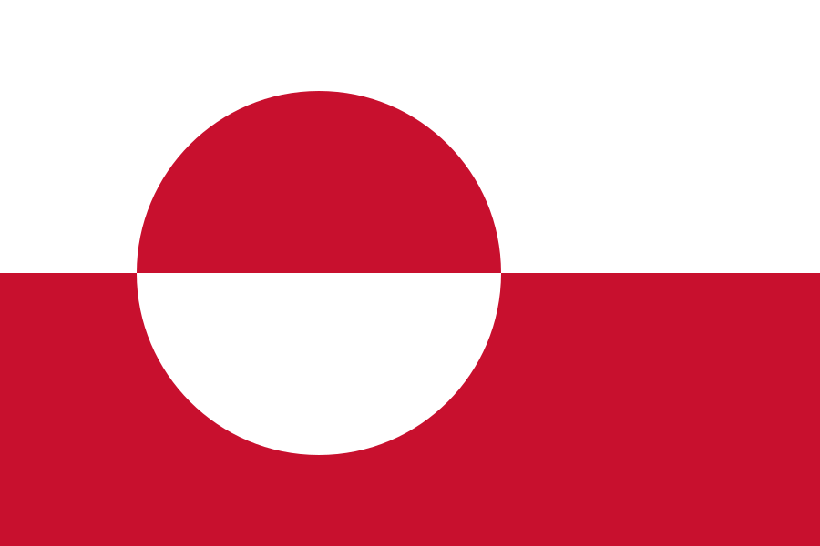<figcaption>Greenland</figcaption></figure>
<figure>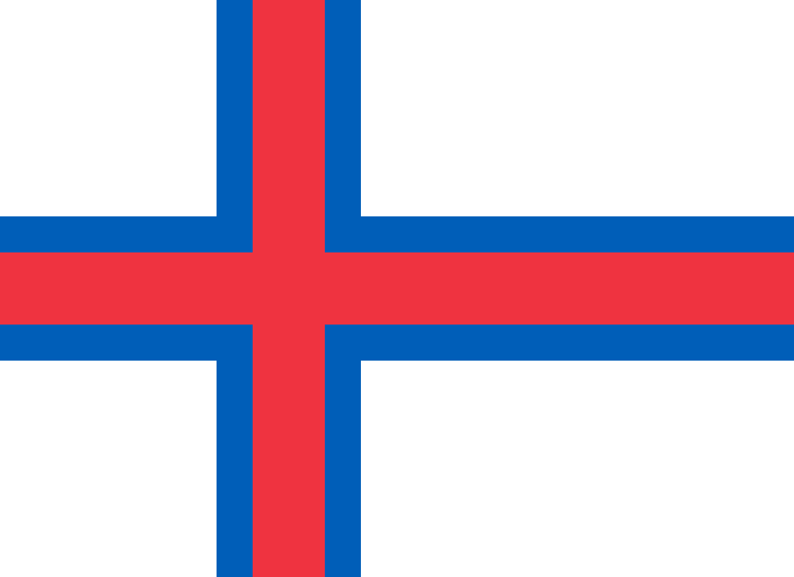<figcaption>Faroe Islands</figcaption></figure>
<figure>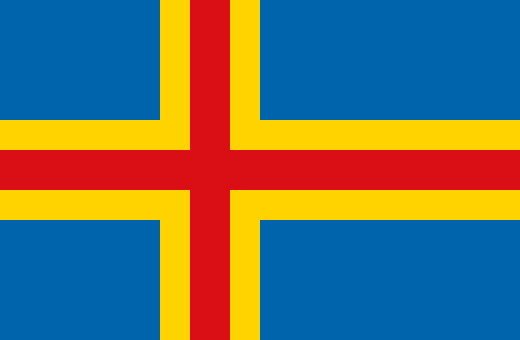<figcaption>Åland</figcaption></figure>
<figure>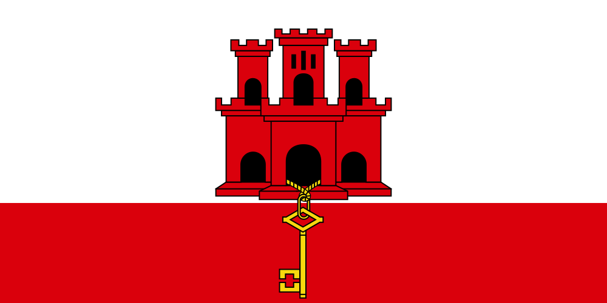<figcaption>Gibraltar</figcaption></figure>
<figure>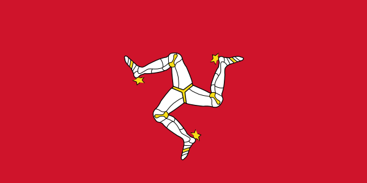<figcaption>Isle of Man</figcaption></figure>
<figure>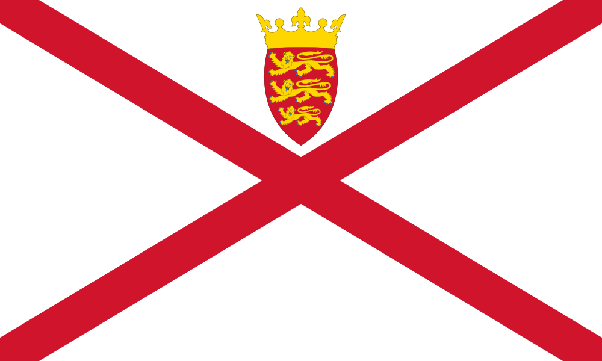<figcaption>Jersey</figcaption></figure>
<figure>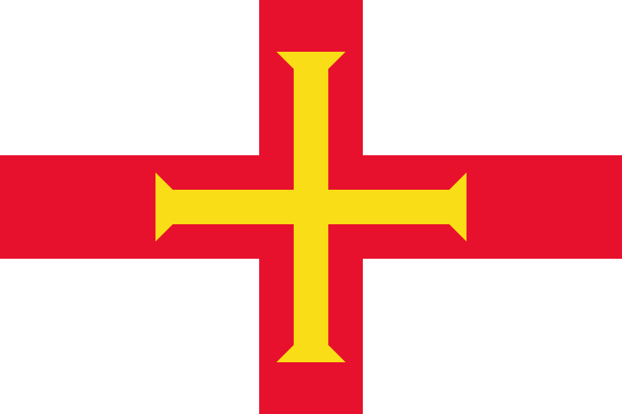<figcaption>Guernsey</figcaption></figure>
<figure>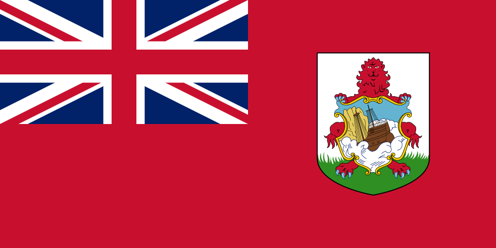<figcaption>Bermuda</figcaption></figure>
<figure>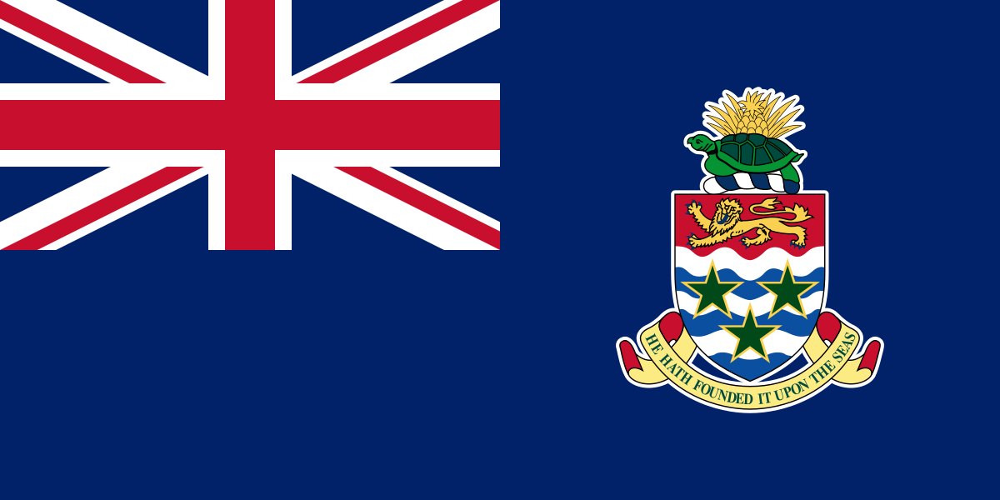<figcaption>Cayman Islands</figcaption></figure>
<figure>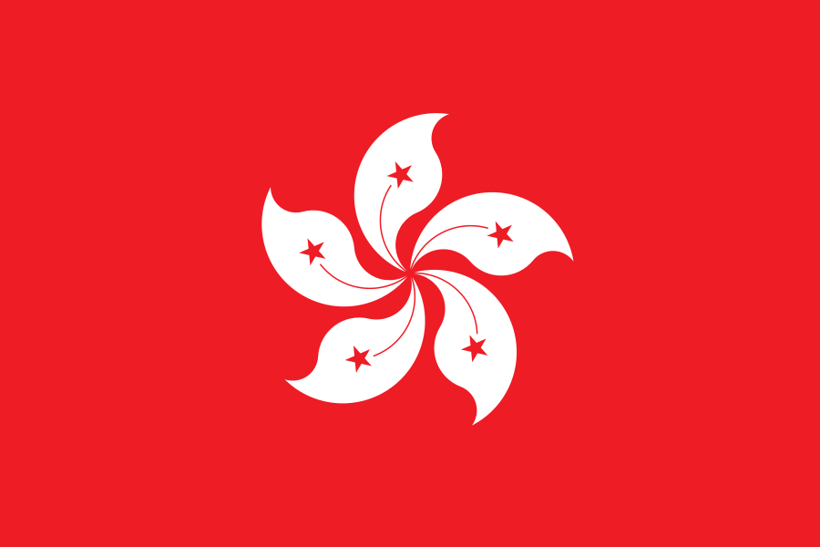<figcaption>Hong Kong</figcaption></figure>
<figure>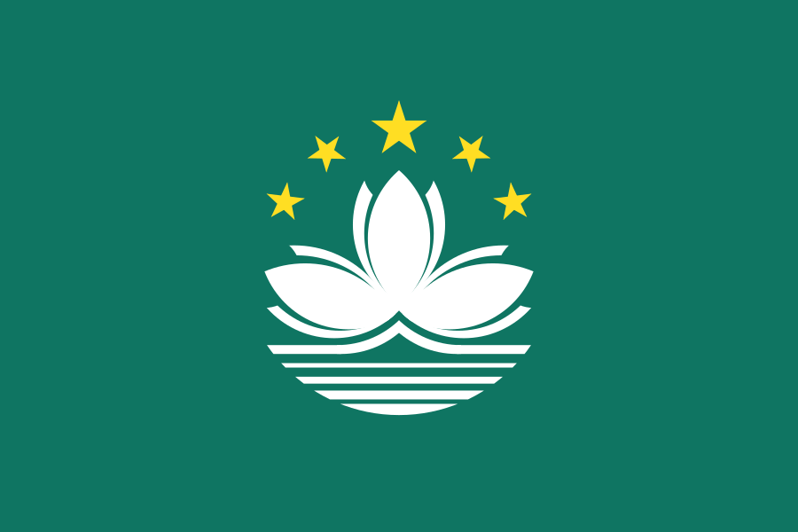<figcaption>Macau</figcaption></figure>
<figure>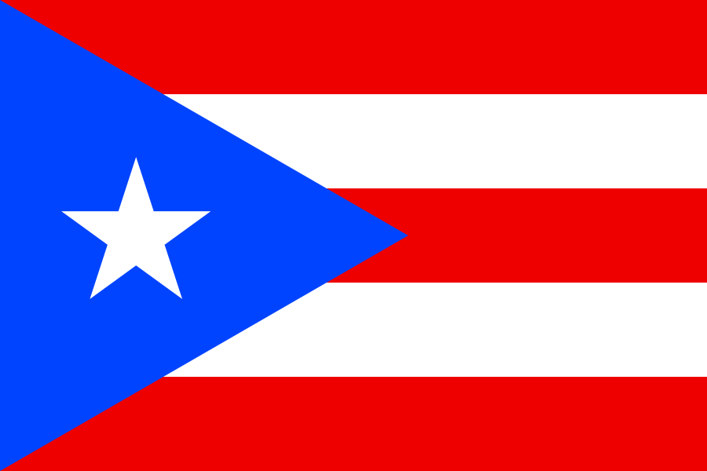<figcaption>Puerto Rico</figcaption></figure>
<figure>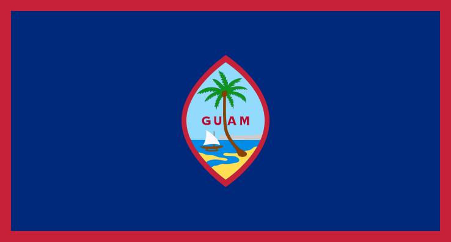<figcaption>Guam</figcaption></figure>
<figure>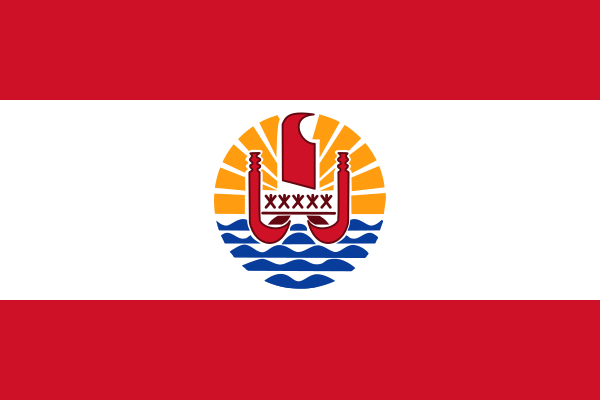<figcaption>French Polynesia</figcaption></figure>
<figure>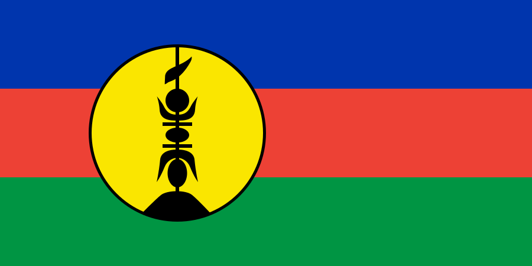<figcaption>New Caledonia</figcaption></figure>
<figure>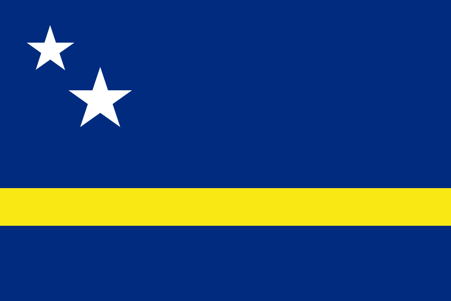<figcaption>Curaçao</figcaption></figure>
<figure>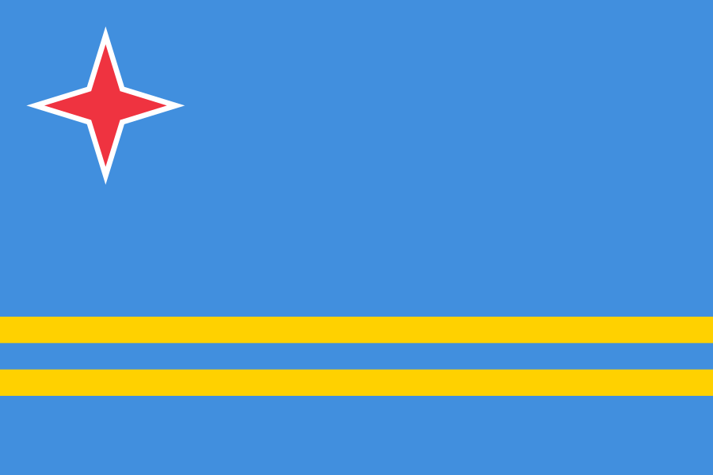<figcaption>Aruba</figcaption></figure>
<figure>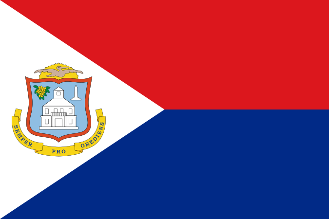<figcaption>Sint Maarten</figcaption></figure>

