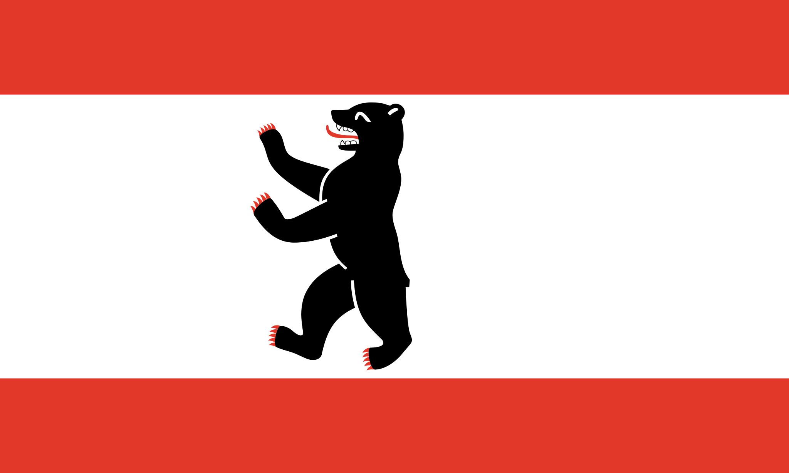
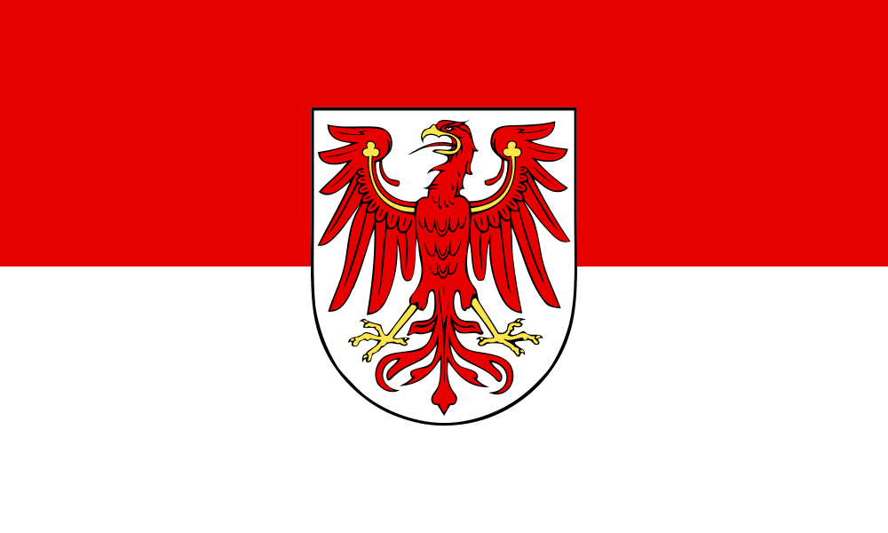
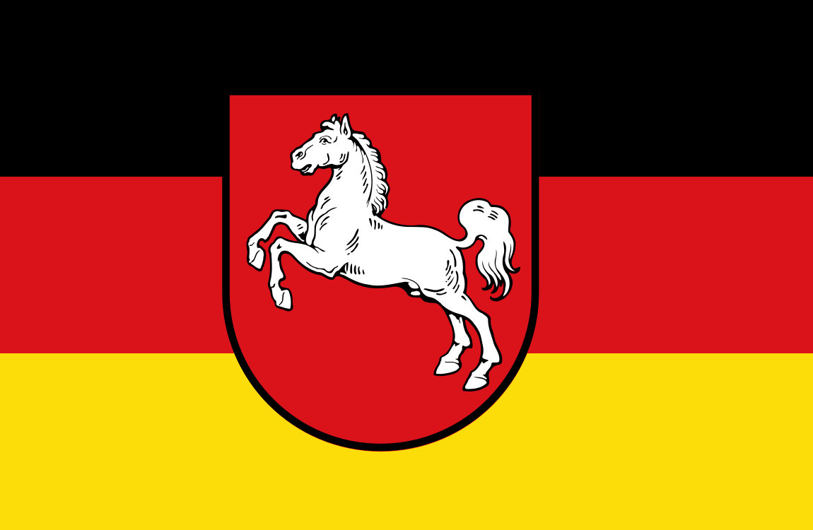
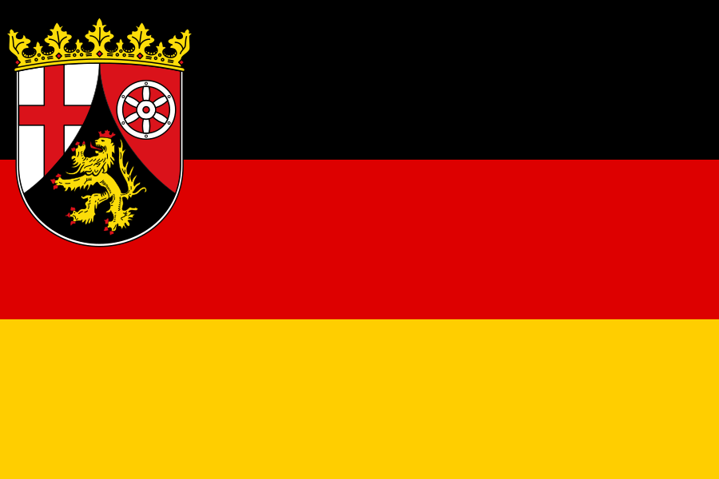
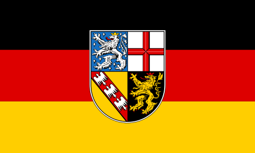
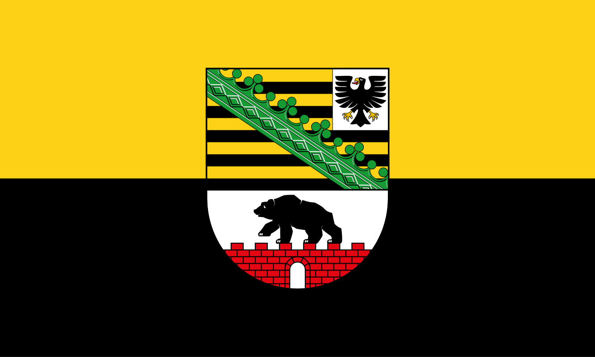

# States (Länder) of Germany

Subnational flags pin a photo *inside* Germany. **Flag-only reference** for now — names + flags, resolved via each subject's Wikidata flag (P41) and cached locally from [Wikimedia Commons](https://commons.wikimedia.org/). May be expanded with recognition notes later.

<figure><figcaption>Baden-Württemberg</figcaption></figure>
<figure><figcaption>Bavaria</figcaption></figure>
<figure><figcaption>Berlin</figcaption></figure>
<figure><figcaption>Brandenburg</figcaption></figure>
<figure><figcaption>Bremen</figcaption></figure>
<figure><figcaption>Hamburg</figcaption></figure>
<figure><figcaption>Hesse</figcaption></figure>
<figure><figcaption>Lower Saxony</figcaption></figure>
<figure><figcaption>Mecklenburg-Vorpommern</figcaption></figure>
<figure><figcaption>North Rhine-Westphalia</figcaption></figure>
<figure><figcaption>Rhineland-Palatinate</figcaption></figure>
<figure><figcaption>Saarland</figcaption></figure>
<figure><figcaption>Saxony</figcaption></figure>
<figure><figcaption>Saxony-Anhalt</figcaption></figure>
<figure><figcaption>Schleswig-Holstein</figcaption></figure>
<figure><figcaption>Thuringia</figcaption></figure>

