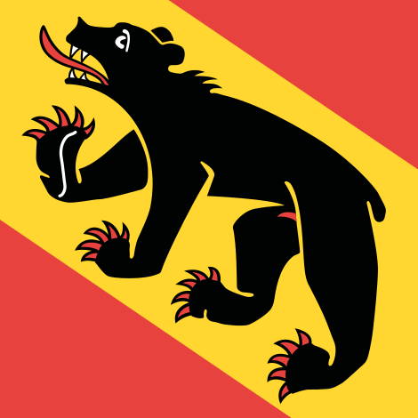
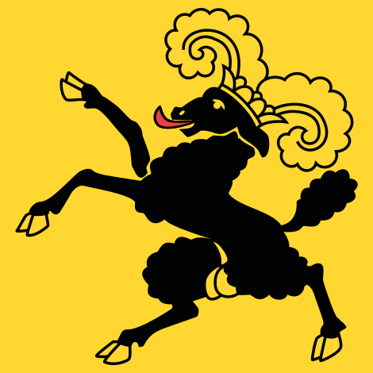
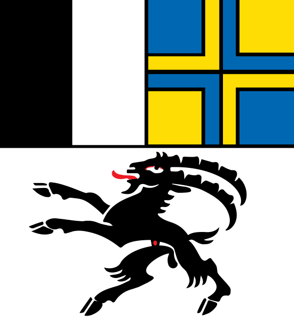
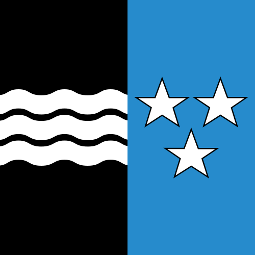
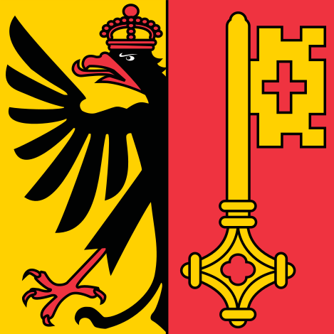

# Cantons of Switzerland

Subnational flags pin a photo *inside* Switzerland. **Flag-only reference** for now — names + flags, resolved via each subject's Wikidata flag (P41) and cached locally from [Wikimedia Commons](https://commons.wikimedia.org/). May be expanded with recognition notes later.

<figure><figcaption>Zürich</figcaption></figure>
<figure><figcaption>Bern</figcaption></figure>
<figure><figcaption>Lucerne</figcaption></figure>
<figure><figcaption>Uri</figcaption></figure>
<figure><figcaption>Schwyz</figcaption></figure>
<figure><figcaption>Obwalden</figcaption></figure>
<figure><figcaption>Nidwalden</figcaption></figure>
<figure><figcaption>Glarus</figcaption></figure>
<figure><figcaption>Zug</figcaption></figure>
<figure><figcaption>Fribourg</figcaption></figure>
<figure><figcaption>Solothurn</figcaption></figure>
<figure><figcaption>Basel-Stadt</figcaption></figure>
<figure><figcaption>Basel-Landschaft</figcaption></figure>
<figure><figcaption>Schaffhausen</figcaption></figure>
<figure><figcaption>Appenzell Ausserrhoden</figcaption></figure>
<figure><figcaption>Appenzell Innerrhoden</figcaption></figure>
<figure><figcaption>St. Gallen</figcaption></figure>
<figure><figcaption>Graubünden</figcaption></figure>
<figure><figcaption>Aargau</figcaption></figure>
<figure><figcaption>Thurgau</figcaption></figure>
<figure><figcaption>Ticino</figcaption></figure>
<figure><figcaption>Vaud</figcaption></figure>
<figure><figcaption>Valais</figcaption></figure>
<figure><figcaption>Neuchâtel</figcaption></figure>
<figure><figcaption>Geneva</figcaption></figure>
<figure><figcaption>Jura</figcaption></figure>

