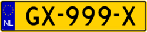
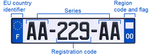
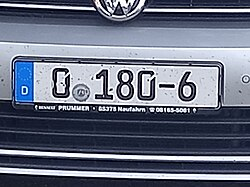
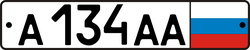
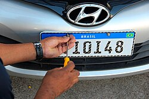

# License plates

Even **blurred** plates (as in Street View) leak information: overall colour, shape, and
band positions survive the blur. Full reference: the comprehensive
[Wikipedia vehicle-registration-plate articles per country](https://en.wikipedia.org/wiki/Vehicle_registration_plate).

## Visual reference (Wikimedia Commons, free licenses)

| | | |
|---|---|---|
|  |  |  |
| [UK rear (yellow)](https://commons.wikimedia.org/wiki/File:Regular_UK_Rear_Registration_Plate.svg) | [Netherlands (yellow)](https://commons.wikimedia.org/wiki/File:Dutch_plate_yellow_NL_car.png) | [France (SIV, two blue bands)](https://commons.wikimedia.org/wiki/File:France_license_plate_(EN).png) |
|  |  |  |
| [Germany (Euro band + seals)](https://commons.wikimedia.org/wiki/File:German_license_plate_0-180-6.jpg) | [Russia (region box right)](https://commons.wikimedia.org/wiki/File:Russian_license_plate_(known_as_federal_plate).png) | [Mercosur/Brazil (blue top band)](https://commons.wikimedia.org/wiki/File:Patente_Mercosur_2018_Brasil.jpg) |

## Europe

- **EU standard plate**: white, long format, **blue band on the left** with the EU stars and
  country code (Council Regulation (EC) 2411/98).[^eu-reg]
- **Netherlands & Luxembourg**: **yellow** plates front and rear — instantly distinctive.[^nl]
- **UK**: white **front**, **yellow rear** (BS AU 145e) — visible even fully blurred.[^uk]
- **France**: white both ends, blue EU band left **plus a blue regional band on the right**
  (since SIV 2009).[^fr]
- **Italy**: blue side bands on **both** edges of the rear plate.
- **Belgium**: white with **red characters** — unique in the EU.[^be]
- **Switzerland**: white front, rear plate carries **canton + Swiss shields** (no EU band).
- **Russia**: white, right-end box with region number + RUS flag (GOST R 50577).[^ru]
- **Ukraine**: white with **blue-yellow band** left.

## Americas

- **USA/Canada**: short, state/province-specific designs; many US states require **no front
  plate** — a rear-only car in N. America suggests such a state.[^us]
- **Mercosur plates** (rolling out since 2016): white with **blue top band** — Brazil
  (black text), Argentina (black), Paraguay, Uruguay.[^mercosur]
- Older Argentina: black-on-white three-letter; older Brazil: grey with black text.

## Asia & Oceania

- **Japan**: white (private), **yellow (kei cars)** — yellow minicars are a strong Japan tell.[^jp]
- **South Korea**: long white plates (new) / green (older).
- **China**: **blue** plates with white text; gradient **green** = EV.[^cn]
- **Indonesia**: **black plates with white text** (being replaced by white since 2022 — date
  the imagery!).[^id]
- **Thailand**: white with black text, province name at bottom.
- **Australia/NZ**: state-varied (AUS); NZ white/black with Euro-long shape common.

## Africa & Middle East

- **South Africa**: province-coded (e.g. **GP** = Gauteng, **WC** = Western Cape) — region
  filter inside the country.[^za]
- **UAE/Saudi**: dual Arabic/Latin; Saudi plates show both scripts.
- **Israel**: **yellow** plates with black text (both ends).

[^eu-reg]: EUR-Lex, [Council Regulation (EC) No 2411/98](https://eur-lex.europa.eu/legal-content/EN/TXT/?uri=CELEX:31998R2411) — the EU registration-plate band.
[^nl]: RDW (Netherlands vehicle authority), [Kentekenplaten regulations](https://www.rdw.nl/particulier/voertuigen/auto/de-kentekenplaat).
[^uk]: UK Government, [Displaying number plates](https://www.gov.uk/displaying-number-plates) — BS AU 145e colour requirement.
[^fr]: Légifrance, arrêté du 9 février 2009 relatif aux plaques d'immatriculation (SIV); summary: [service-public.fr](https://www.service-public.fr/particuliers/vosdroits/F20322).
[^be]: Belgian Official Gazette, plate format AR/KB 20.07.2001; Wikipedia, [Vehicle registration plates of Belgium](https://en.wikipedia.org/wiki/Vehicle_registration_plates_of_Belgium).
[^ru]: GOST R 50577-2018 (Russian state standard for registration plates).
[^us]: AAA digest of state laws, [front plate requirements by state](https://drivinglaws.aaa.com/); Wikipedia, [US license plate front requirement map](https://en.wikipedia.org/wiki/Vehicle_registration_plates_of_the_United_States).
[^mercosur]: Mercosur Resolution GMC 33/14 (common plate); Wikipedia, [Mercosur license plates](https://en.wikipedia.org/wiki/Mercosur_license_plates).
[^jp]: Japan MLIT, [vehicle registration plate categories](https://www.mlit.go.jp/jidosha/jidosha_fr1_000028.html); kei-car yellow plates.
[^cn]: MPS GA36-2018 standard; Wikipedia, [Vehicle registration plates of China](https://en.wikipedia.org/wiki/Vehicle_registration_plates_of_China).
[^id]: Indonesian Police Regulation (Perpol) No. 7/2021 — black→white plate transition; Jakarta Post coverage, June 2022.
[^za]: Wikipedia, [Vehicle registration plates of South Africa](https://en.wikipedia.org/wiki/Vehicle_registration_plates_of_South_Africa) (per-province prefixes, sourced to eNaTIS).
