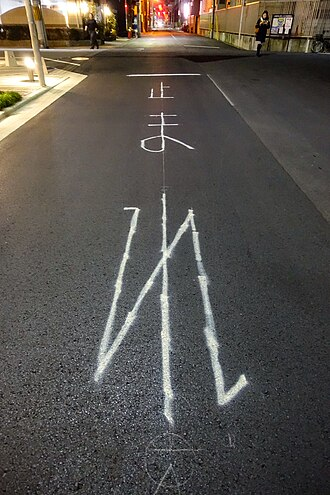

# Road signs & chevrons

📷 **[Road-sign photo gallery by country](commons/road-signs.md)** — real signage from ~37 countries (Wikimedia Commons, cached locally).

## The two great signage families

| System | Warning signs | Where |
|---|---|---|
| **Vienna Convention** (1968)[^vienna] | **Red-bordered white/yellow triangles** | Europe, Russia/CIS, most of Middle East, much of Africa & Asia |
| **MUTCD** (US)[^mutcd] | **Yellow diamonds** | USA, Canada (variant), Mexico & Latin America, Australia/NZ (variant), Japan, Indonesia, Thailand, Malaysia, Philippines, Liberia |

Within the Vienna family, the warning-triangle **background colour** splits further:
**yellow backgrounds** in Sweden, Finland, Iceland, Greece, Poland (and Norway's are white
with red border but Sweden/Finland yellow) vs **white backgrounds** in most of the rest of
Europe.[^euro-comp]

## Stop & give-way

- The red octagon STOP is near-universal (both conventions).
- **Japan**: inverted red triangle with 止まれ — unique worldwide.[^japan-stop]

*Japan's inverted-triangle stop sign ([Wikimedia Commons](https://commons.wikimedia.org/wiki/File:%E6%AD%A2%E3%81%BE%E3%82%8C_(46865483085).jpg), CC).*
- Give-way: inverted white/yellow triangle with red border everywhere in the Vienna family.

## Curve chevrons (high-value tell)

The most distinctive chevron styles, verified against the European signage comparison tables:[^euro-comp]

| Style | Country |
|---|---|
| White chevron on **black** board | United Kingdom, Ireland |
| White chevron on **blue** board | France, Spain (blue/white), Portugal |
| **Yellow-on-blue** | Sweden |
| **Black-on-yellow** | Finland, Norway, Iceland, Greece; also US/CAN/AUS arrow boards |
| **White-on-red** | Russia, Belarus, Ukraine (red board, white arrows) |
| **Red-on-white** | Germany (Zeichen 625 — red chevrons on white board; verified against the official StVO render below) |

Netherlands and Belgium use related white-board designs whose exact pattern has varied —
confirm the current national style against a live signage reference.

*Germany's official Zeichen 625 curve board — red chevrons on white, black border — exact StVO render
([Wikimedia Commons](https://commons.wikimedia.org/wiki/File:Zeichen_625-11_-_Richtungstafel_in_Kurven_%28Aufstellung_rechts%29,_500x1500,_StVO_1992.svg), public domain as official work).*

!!! warning
    Chevron schemes are among the metas that countries refresh — confirm the live photo against
    a current signage catalogue before relying on one in a report.

Traffic signals are their own rich clue family — see the dedicated
**[Traffic lights page](traffic-lights.md)** (with a 176-photo gallery).

## Sign-back & pole details

- **Sign backplate colour**: grey metal backs are universal, but e.g. Italy often paints sign
  backs grey-green, Japan uses distinctive round-tube double poles, and Poland mounts signs
  on galvanized U-channel — the *mounting hardware* is regionally consistent.
- **Km posts/mile markers**: France's red-topped "borne kilométrique", Spain's hito posts,
  US green mile markers — distinctive per-country kilometre/mile-post styles.

[^vienna]: UNECE, [Vienna Convention on Road Signs and Signals (1968)](https://unece.org/transport/road-traffic/vienna-convention-road-signs-and-signals) — treaty text and list of contracting parties.
[^mutcd]: FHWA, [MUTCD, Part 2 — Signs](https://mutcd.fhwa.dot.gov/); Wikipedia, [Comparison of MUTCD-influenced traffic signs](https://en.wikipedia.org/wiki/Comparison_of_MUTCD-influenced_traffic_signs) for the derivative national systems.
[^euro-comp]: Wikipedia, [Comparison of European road signs](https://en.wikipedia.org/wiki/Comparison_of_European_road_signs) — side-by-side renders of every sign class per country, with sources to national regulations.
[^japan-stop]: Japan National Police Agency road sign regulations; Wikipedia, [Road signs in Japan](https://en.wikipedia.org/wiki/Road_signs_in_Japan).
