# Natural landmarks

Anchors for horizon-matching and background identification. Coordinates from
[GeoNames](https://www.geonames.org/) / national surveys; verify peaks against
[PeakVisor](https://peakvisor.com/) renders.[^geonames]

## Visual reference (Wikimedia Commons, free licenses)

| | | | |
|---|---|---|---|
| 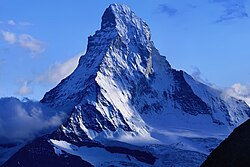 | 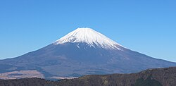 | 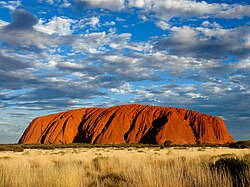 | 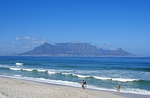 |
| [Matterhorn](https://commons.wikimedia.org/wiki/File:Matterhorn_from_Domh%C3%BCtte_-_2.jpg) | [Mount Fuji](https://commons.wikimedia.org/wiki/File:View_of_Mount_Fuji_from_%C5%8Cwakudani_20211202.jpg) | [Uluru](https://commons.wikimedia.org/wiki/File:ULURU.jpg) | [Table Mountain](https://commons.wikimedia.org/wiki/File:Table_Mountain_DanieVDM.jpg) |
| 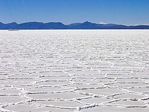 | 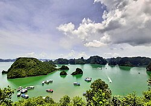 | 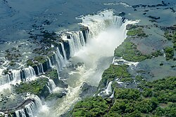 | 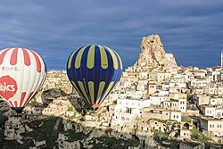 |
| [Salar de Uyuni](https://commons.wikimedia.org/wiki/File:Salar_Uyuni_au01.jpg) | [Ha Long Bay](https://commons.wikimedia.org/wiki/File:Ha_Long_Bay_in_2019.jpg) | [Iguazú Falls](https://commons.wikimedia.org/wiki/File:Iguazu_Cataratas2.jpg) | [Cappadocia](https://commons.wikimedia.org/wiki/File:Cappadocia_balloon_trip,_Ortahisar_Castle_(11893715185).jpg) |
| 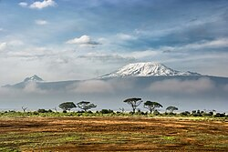 | 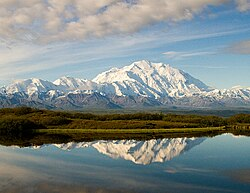 | 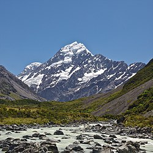 | 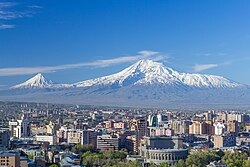 |
| [Kilimanjaro](https://commons.wikimedia.org/wiki/File:Kilimanjaro_from_Amboseli.jpg) | [Denali](https://commons.wikimedia.org/wiki/File:Wonder_Lake_and_Denali.jpg) | [Aoraki / Mt Cook](https://commons.wikimedia.org/wiki/File:Mt_Cook_LC0247.jpg) | [Ararat](https://commons.wikimedia.org/wiki/File:Mount_Ararat_and_the_Yerevan_skyline_in_spring_(50mm).jpg) |
| 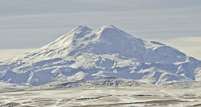 | 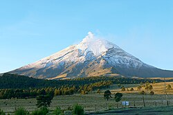 | 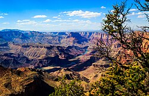 | 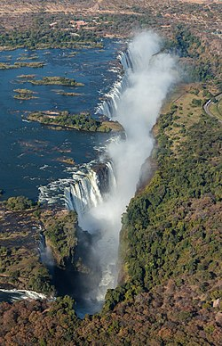 |
| [Elbrus](https://commons.wikimedia.org/wiki/File:Mount_Elbrus_(cropped).jpg) | [Popocatépetl](https://commons.wikimedia.org/wiki/File:Mexico-Popocatepetl.jpg) | [Grand Canyon](https://commons.wikimedia.org/wiki/File:Canyon_River_Tree_(165872763).jpeg) | [Victoria Falls](https://commons.wikimedia.org/wiki/File:Cataratas_Victoria,_Zambia-Zimbabue,_2018-07-27,_DD_04.jpg) |
| 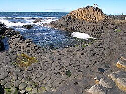 | 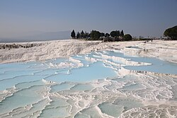 | 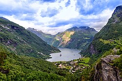 | 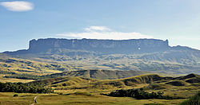 |
| [Giant's Causeway](https://commons.wikimedia.org/wiki/File:Causeway-code_poet-4.jpg) | [Pamukkale](https://commons.wikimedia.org/wiki/File:Pamukkale,_Denizli_2026_68.jpg) | [Geirangerfjord](https://commons.wikimedia.org/wiki/File:Geirangerfjord_.jpg) | [Roraima](https://commons.wikimedia.org/wiki/File:Roraima3_(79).JPG) |

## Mountains usable as skyline fingerprints

| Landmark | Coordinates | Recognition |
|---|---|---|
| Matterhorn (CH/IT) | 45.9766, 7.6585 | Asymmetric pyramid — visible Zermatt side vs Italian side differ |
| Mont Blanc (FR/IT) | 45.8326, 6.8652 | Dome massif over Chamonix |
| Fuji (JP) | 35.3606, 138.7274 | Perfect solitary cone, snowcap Oct–May |
| Kilimanjaro (TZ) | -3.0674, 37.3556 | Flat-topped massif rising from savanna; shrinking glacier |
| Table Mountain (ZA) | -33.9628, 18.4098 | Flat 3-km plateau over Cape Town |
| Denali (US-AK) | 63.0692, -151.0070 | Hugely prominent over tundra |
| Aoraki/Mt Cook (NZ) | -43.5950, 170.1418 | Sharp ridge over turquoise glacial lakes |
| Ararat (TR) | 39.7020, 44.2988 | Twin cones (Greater + Little Ararat) on plain |
| Vesuvius (IT) | 40.8214, 14.4260 | Crescent Somma rim around cone, Bay of Naples |
| Popocatépetl (MX) | 19.0224, -98.6279 | Often-active plume SE of Mexico City |
| Damavand (IR) | 35.9550, 52.1100 | Solitary cone north of Tehran |
| Elbrus (RU) | 43.3499, 42.4453 | Twin-summit dome, highest in Europe |

## Water & geology

| Landmark | Coordinates | Recognition |
|---|---|---|
| Grand Canyon (US) | 36.0544, -112.1401 | Banded red strata, rim vegetation |
| Iguazú Falls (AR/BR) | -25.6953, -54.4367 | Multi-tier curtain falls in jungle |
| Victoria Falls (ZM/ZW) | -17.9243, 25.8572 | Knife-slot gorge, spray column |
| Uluru (AU) | -25.3444, 131.0369 | Monolith, red centre |
| Giant's Causeway (UK) | 55.2408, -6.5116 | Hexagonal basalt columns |
| Pamukkale (TR) | 37.9203, 29.1206 | White travertine terraces |
| Salar de Uyuni (BO) | -20.1338, -67.4891 | Endless white salt flat; mirror season Dec–Apr |
| Geirangerfjord (NO) | 62.1049, 7.0926 | Switchback roads above sheer fjord |
| Ha Long Bay (VN) | 20.9101, 107.1839 | Karst towers from sea |
| Cappadocia (TR) | 38.6431, 34.8289 | Fairy chimneys + hot-air balloons at dawn |
| Mount Roraima (VE/GY/BR) | 5.1433, -60.7625 | Sheer-walled tepui |
| Dead Sea (IL/JO) | 31.5, 35.5 | Below-sea-level haze, salt crust shorelines |

## Identification practice

For any mountain backdrop: take the ridgeline profile → [PeakVisor panorama](https://peakvisor.com/panorama.html)
or [PeakFinder](https://www.peakfinder.com/) at candidate coordinates → rotate to match.
This is the technique Bellingcat volunteers use for conflict-zone footage.[^nieman]

[^geonames]: [GeoNames geographical database](https://www.geonames.org/) (CC-BY) — 11M+ placenames with coordinates; cross-check elevations with USGS/NASA SRTM.
[^nieman]: Nieman Reports, [Lessons from building an online toolkit for open-source investigations](https://niemanreports.org/osint-open-source-investigations-bellingcat-volunteers/).
