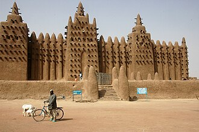
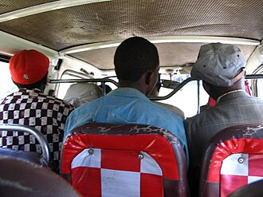

# Africa — recognition notes

Google SV coverage is partial; many countries have only trekker or partner imagery — the
coverage map is itself a filter.[^coverage] Guides: [PlonkIt](https://www.plonkit.net/guide).

| | |
|---|---|
|  |  |
| Sahel mud-brick (Djenné, Mali) — [source](https://commons.wikimedia.org/wiki/File:Djenne_great_mud_mosque.jpg) | Matatu = Kenya — [source](https://commons.wikimedia.org/wiki/File:Kenia_matatu.jpg) |

## Southern Africa

- **South Africa** (LHT): yellow edge lines; province-coded plates (GP/WC/KZN…); RDP housing
  grids; Highveld grassland vs Cape fynbos; 11-language signage.
- **Botswana** (LHT): blue-ish plates; flat Kalahari scrub; donkeys on roads.
- **Namibia** (LHT): gravel C-roads, red dunes (south), German colonial architecture
  (Lüderitz/Swakopmund).
- **Eswatini/Lesotho** (LHT): Lesotho = highland (often >2000 m), rondavel huts.

## East Africa

- **Kenya** (LHT): snorkel on the Google car (older passes)[^cars]; red soil + acacia;
  matatus with slogans; M-PESA green shop paint.
- **Uganda** (LHT): boda-bodas everywhere; red murram roads; banana groves.
- **Tanzania** (LHT): Swahili signage ("duka"); Maasai cattle; baobabs on plains.
- **Rwanda** (RHT!): one of few RHT in E. Africa; immaculate roads, moto-taxi helmets.
- **Ethiopia**: Ge'ez/Amharic script — instant ID; blue-white Lada taxis (Addis).

## West & Central Africa

- **Nigeria** (RHT): police escort visible in much older Google passes[^cars]; okada bikes;
  green-white plates.
- **Ghana** (RHT): Google car roof straps in classic imagery[^cars]; red-yellow-green kiosks;
  "chop bar" signage in English.
- **Senegal** (RHT): French signage; yellow-black taxis; baobabs + flat Sahel.
- **DR Congo / Congo**: French; deep red laterite; minimal official coverage.
- **Côte d'Ivoire**: orange taxis (Abidjan), French signage.

## North Africa

- **Morocco**: Arabic + French + **Tifinagh** (ⵜⴰⵎⴰⵣⵉⵖⵜ) tri-script signs — Tifinagh is
  decisive[^tifinagh]; petit-taxi colour per city (red=Casablanca, blue=Rabat).
- **Tunisia**: Arabic+French; white-blue Sidi Bou Said palette on the coast.
- **Egypt**: Arabic-only dominant; black-white taxis (Cairo); desert highways with sand drift.
- **Algeria/Libya**: limited or no Google SV — claims need other imagery sources.

## Complete coverage — the remaining countries

| Country | Where / Recognition |
|---|---|
| **Algeria / Libya** | No official SV; Algeria's French+Arabic signage vs Libya's Arabic-only |
| **Sudan / South Sudan** | Khartoum's Nile confluence; SSD split 2011 — flags & plates differ |
| **Mali / Burkina Faso / Niger / Chad** | Sahel belt: French signage, red laterite, mud-brick (Djenné mosque style in Mali); minimal SV |
| **Mauritania** | Sahara meets Atlantic; the iron-ore train; white boubous; Arabic+French |
| **Gambia / Guinea / Guinea-Bissau / Sierra Leone** | W. African coast; The Gambia = English sliver inside francophone Senegal; Bissau = Portuguese |
| **Liberia** | Founded by freed US slaves: English, US-style flag, **MUTCD-style signage**, drives right |
| **Togo / Benin** | Coastal francophone strips; Benin's yellow-shirt zemidjan moto-taxis; voodoo iconography |
| **Cameroon** | Bilingual French/English (anglophone west); Mount Cameroon |
| **CAR / Gabon / Congo-Brazzaville / Eq. Guinea** | Equatorial forest, French (Sp. for Eq. Guinea); minimal coverage |
| **Angola** | **Portuguese** signage; Luanda's bay; kwanza prices |
| **Zambia / Zimbabwe / Malawi** (all LHT) | English signage; ZM copper belt; ZW's balancing-rocks motif (on old notes); Malawi's lake dominates |
| **Mozambique** (LHT) | **Portuguese + drives left** — that combo is nearly unique (also Macau/Timor) |
| **Madagascar** (RHT) | French; zebu carts; Avenue of the Baobabs; Malagasy (Austronesian!) names |
| **Mauritius / Seychelles** (LHT) | Indian Ocean islands; Mauritius sugarcane + Hindu temples; Seychelles granite boulders |
| **Comoros / Cape Verde / São Tomé** | Arabic+French / Portuguese creole / Portuguese — language splits them instantly |
| **Eritrea / Djibouti / Somalia** | Ge'ez script (ER), French+Arabic (DJ); Somalia minimal coverage |

[^coverage]: Wikipedia, [Coverage of Google Street View](https://en.wikipedia.org/wiki/Coverage_of_Google_Street_View); Google, [coverage explorer](https://www.google.com/streetview/explore/).
[^cars]: GeoHints, [Google Cars](https://geohints.com/cars) — fleet photo documentation per country & era.
[^tifinagh]: IRCAM (Royal Institute of Amazigh Culture), Tifinagh standardization; Morocco's 2011 constitution Art. 5 making Amazigh official.
