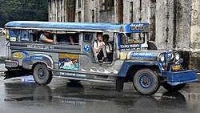
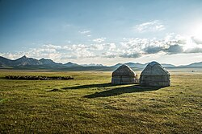
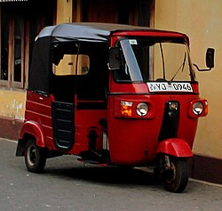

# Asia — recognition notes

Photo-documented per-country guides: [PlonkIt](https://www.plonkit.net/guide).[^plonkit]

| | | |
|---|---|---|
|  |  |  |
| Jeepney = Philippines — [source](https://commons.wikimedia.org/wiki/File:Jeepney,_Magallanes_Drive,_Intramuros,_2018_(02).jpg) | Gers = Mongolia/C. Asia — [source](https://commons.wikimedia.org/wiki/File:SK_yurt_camp_(1_of_1)-8.jpg) | Auto-rickshaw = S./SE Asia — [source](https://commons.wikimedia.org/wiki/File:Bajaj_auto-rickshaw_in_Sri_Lanka.jpg) |

## East Asia

- **Japan**: LHT; kana on every sign; kei-car yellow plates; grey tiled roofs; vending
  machines; cylindrical transformers on concrete poles; inverted-triangle stop sign.
- **South Korea**: RHT + hangul; yellow centre lines; green highway signs; church crosses on
  skylines; Kakao/Naver maps better than Google (Google SV sparse due to mapping-export
  restrictions[^kr]).
- **China**: no Google SV — imagery claiming otherwise is Baidu/Tencent or fake; simplified
  characters; blue plates; massive identical apartment clusters; expressway green signs.
- **Taiwan**: traditional characters + scooters in huge numbers + betel-nut kiosks.
- **Mongolia**: Cyrillic (ө/ү); gers visible at city edges; dirt roads radiating across
  steppe; Google car often a pickup.[^plonkit]

## Southeast Asia

- **Thailand** (LHT): Thai script; yellow-top tuk-tuks; orange-robed monks; tall square
  concrete poles; red-white kerbstones.
- **Vietnam** (RHT): Latin script with heavy stacked diacritics; motorbike rivers; narrow
  "tube houses" 3-5 storeys, one room wide.
- **Cambodia/Laos**: Khmer vs Lao script is the separator; both RHT, dusty red laterite
  side roads.
- **Indonesia** (LHT): black (→white) plates; "Indomaret/Alfamart" shops; mosques + scooters;
  red-tile kampung roofs.
- **Malaysia** (LHT): Malay in Latin script; "Jalan" street signs; shophouses; dual-language
  Chinese areas. **Singapore**: dense high-rise HDB blocks, immaculate roads.
- **Philippines** (RHT): jeepneys, English/Tagalog mix, sari-sari stores, US-style yellow
  centre lines.[^plonkit]

## South Asia

- **India** (LHT): script changes by state (Devanagari, Tamil, Telugu, Kannada, Bengali…)
  — the *script itself* is the state filter; Ambassador/Tata vehicles; painted truck art
  ("HORN OK PLEASE"); black-yellow autorickshaws.
- **Pakistan**: Urdu nastaliq; decorated trucks; green-white plates in some provinces.
- **Bangladesh**: Bengali script; cycle rickshaws in extreme density; green CNG autos.
- **Sri Lanka**: Sinhala script; red-brown soil + palms; tuk-tuks; LHT.
- **Nepal**: Devanagari + Himalayan terrain; prayer flags; suspension footbridges.

## Central Asia & Caucasus

- **Kazakhstan**: Kazakh Cyrillic extras (ә қ ғ ң ұ); vast steppe; Soviet planning grid.
- **Kyrgyzstan**: ө/ү letters; mountains visible from almost everywhere.
- **Uzbekistan**: Latin Uzbek (oʻ gʻ apostrophes); Chevrolet near-monopoly on cars.[^uz]
- **Georgia**: unique round script; Caucasus backdrops; Lada+Mercedes mix.
- **Armenia**: unique script; pink tuff stone buildings (Yerevan).
- **Azerbaijan**: Latin with ə — the ə alone is decisive.

## Middle East

- **Israel**: Hebrew + yellow plates. **Palestine (West Bank)**: white/green plates.
- **UAE/Qatar**: hyper-modern highways, sand verges, bilingual gantries.
- **Saudi Arabia**: bilingual plates, brown desert, SASO-pattern signage.
- **Jordan/Lebanon**: Arabic+French (LB) vs Arabic+English (JO) secondary language.
- **Iran**: Persian extra letters (پ چ گ ژ); no Google SV; Paykan/Pride cars.
- **Turkey**: ğ/ş/ı; red crescent flags; D-road numbering; galvanized poles.

## Complete coverage — the remaining countries

| Country | Where / Recognition |
|---|---|
| **Afghanistan** | No Google Street View; Dari/Pashto (Arabic script); decorated "jingle trucks"; mud-brick compounds |
| **Turkmenistan** | No SV; Ashgabat's white-marble buildings and gold statues are unmistakable in any imagery |
| **Tajikistan** | Pamir Highway switchbacks; Somoni portraits; Cyrillic Tajik (ӣ ӯ ҷ ҳ) |
| **Brunei** (LHT) | Between two Malaysian states on Borneo; gold-domed mosques; immaculate roads; no alcohol ads |
| **Maldives** | **Thaana script** — written right-to-left, found nowhere else on Earth; atoll islands |
| **Bhutan** (LHT) | Dzong fortress architecture mandated by law; famously **no traffic lights** in Thimphu; Dzongkha |
| **North Korea** | No SV; any street imagery is press/tourist footage — verify via monuments (Juche Tower, Ryugyong) |
| **Macau** (LHT) | Portuguese + Chinese bilingual street signs; calçada wave-pattern pavements; casino towers |
| **Timor-Leste** | Portuguese/Tetum signage in SE Asia (RHT) — the Portuguese is the tell vs Indonesia |
| **Oman** | Spotless highways, white/beige low-rise rule, dishdasha + kuma caps; ROP plates |
| **Kuwait / Bahrain / Qatar** | Gulf monotone: separate via plates and landmarks (Kuwait Towers, Bahrain WTC, Doha skyline) |
| **Lebanon** | Arabic + French; Mediterranean terracing; older Mercedes taxis; war-era pockmarks in Beirut |
| **Syria / Iraq / Yemen** | No/minimal SV; rely on satellite + social media imagery and the verification workflow |
| **Laos vs Thailand** | Same family of scripts — Lao is rounder with fewer characters; Laos RHT vs Thailand LHT is decisive in one glance |

[^plonkit]: PlonkIt country guides, [plonkit.net/guide](https://www.plonkit.net/guide) — every bullet above is photo-verified on the matching country page; see also GeoHints per-category pages.
[^kr]: Reuters/Yonhap reporting on South Korea's map-data export restrictions (Land Survey Act); summarized in Wikipedia, [Restrictions on geographic data in South Korea](https://en.wikipedia.org/wiki/Restrictions_on_geographic_data_in_South_Korea).
[^uz]: GM Uzbekistan market-share reporting (Reuters); visible empirically in any Tashkent street scene.
