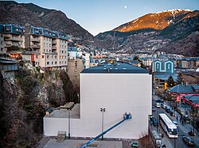
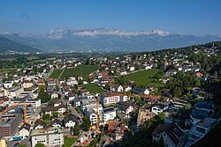
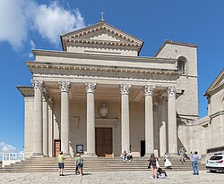
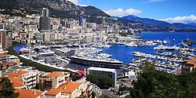
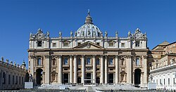
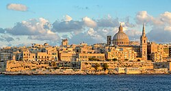
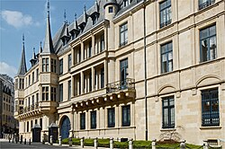
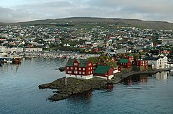
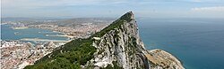
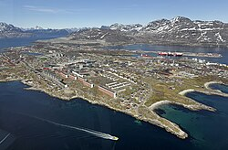

# Europe — recognition notes

Per-country deep guides with photos: [PlonkIt](https://www.plonkit.net/guide) (each country
has a dedicated sourced page). Below are the load-bearing distinctions.[^plonkit]

## Nordics

- **Norway**: yellow centre lines (unique in Nordics today), fjord terrain, red/white wooden
  houses, tunnels everywhere. [PlonkIt/Norway](https://www.plonkit.net/norway).
- **Sweden**: white lines, yellow-on-blue chevrons, falu-red houses, gentler terrain than NO.
- **Finland**: white lines (yellow before June 2020 — date the imagery![^finland]), straight
  forest roads, slim bollards, bilingual Finnish/Swedish signs on the coast.
- **Denmark**: flat, brick farmhouses, cycle lanes everywhere, J-shaped lamp posts.
- **Iceland**: treeless volcanic landscape, black-sand shoulders, yellow-on-black chevrons.

## Western Europe

- **UK**: LHT, yellow rear plates, black-on-white chevrons (white-on-black boards), hedgerows,
  brick terraces. **Ireland**: LHT + km/h limits in white circles + green road signage +
  bilingual Irish.
- **France**: wrap-around red bollard bands, white-on-blue chevrons, D-road markers (red-top
  bornes), plane-tree avenues, lattice pylons.
- **Germany**: Leitpfosten with trapezoid reflector, very sparse SV before 2023[^germany],
  Fachwerk towns, no general Autobahn speed limit signage pattern.
- **Netherlands**: cycle infrastructure density, yellow plates, no-centre-line rural roads.
- **Belgium**: red-character plates, concrete-slab roads near Flanders, FR/NL signage split.
- **Switzerland**: yellow pedestrian crossings (unique), blue motorway signs vs green in IT/FR
  pattern differences, chalets.

## Southern Europe

- **Spain**: wedge bollards with orange reflectors, hito kilometre posts, olive groves +
  white villages (Andalucía), ladder-hole concrete poles.
- **Portugal**: cobbled pavements (calçada), azulejo tiles on facades, .pt, EN/N road codes.
- **Italy**: black-top bollards with red rectangle, grey-green sign backs, autostrada green
  signs, cypress + umbrella pines, "SS/SP" road codes.
- **Greece**: yellow warning-sign backgrounds, Greek script, white cubic island houses,
  mountainous + olive.

## Central & Eastern Europe

- **Poland**: non-wrapping red stripe bollard, dense Catholic roadside shrines, "DK" national
  roads.
- **Czechia/Slovakia**: orange-stripe bollards; Czech ř on signs vs Slovak ľ.
- **Hungary**: ő/ű on signage is decisive; A-frame concrete poles.
- **Romania**: Dacia density, horse carts in rural areas, ț/ș diacritics, lattice poles.
- **Baltics**: similar landscapes; separate by language (ė→LT, ņ→LV, õ→EE) and plate bands.
- **Ukraine**: ї/є on signs, blue-yellow plate strip, chernozem fields, Orthodox domes.
- **Russia**: GOST black-stripe bollards, wooden houses w/ concrete pole struts, 8-xxx phone
  format. Coverage mostly Yandex, Google SV limited/old.[^coverage]

## Microstates & small territories — where they are, how to spot them

| Country | Where it is | Recognition |
|---|---|---|
| **Andorra** | High Pyrenees valleys **between France and Spain** | The only sovereign Catalan-language state — Catalan signage everywhere; duty-free shopping strips; CG/CS road codes; ski resorts; tobacco terraces |
| **Liechtenstein** | Upper **Rhine valley between Switzerland and Austria** | FL plates (black with crown); Swiss francs & Swiss-style infrastructure; Vaduz Castle on the hillside above the capital |
| **San Marino** | Hilltop enclave **inside Italy**, ~10 km inland from Rimini | Monte Titano's three towers on the skyline; light-blue/white plates with no EU band; RSM country stickers |
| **Monaco** | 2 km² enclave on the **French Riviera**, surrounded by France | High-rises squeezed between sea and cliff; F1 barriers and the tunnel; casino quarter; blue-on-white plates |
| **Vatican City** | Walled enclave **inside Rome** | St Peter's dome from everywhere; SCV plates; Swiss Guard uniforms |
| **Malta** | Island 90 km **south of Sicily** | **Drives left**; UK-style white/yellow plates; honey limestone everywhere; red UK phone boxes; Maltese — the only Semitic language in Latin script |
| **Luxembourg** | Wedged between **Belgium, France and Germany** | Yellow plates both ends; LU trilingual signage (Lëtzebuergesch/FR/DE); capital built around a gorge |
| **Cyprus** | Eastern Mediterranean, south of Turkey | **Drives left**; Greek south / Turkish north with UN buffer; British base areas |
| **Gibraltar** | UK territory on **Spain's southern tip** | **Drives on the right** despite UK signage; the Rock looms over everything; red postboxes; GX plates |
| **Faroe Islands** (DK) | North Atlantic, **between Iceland and Norway** | Grass-roofed houses; treeless green fjords; FO plates; Faroese ð on signs |
| **Isle of Man / Channel Islands** | Irish Sea / off Normandy | Drive left; UK-style but own plates (triskelion symbol = Man); Jersey/Guernsey GBJ/GBG |
| **Greenland** (DK) | Between North Atlantic and Arctic | Brightly painted detached houses on bare rock; **no roads between towns**; Danish + Greenlandic |
| **Åland** (FI) | Archipelago between Sweden and Finland | Swedish-only signage inside Finland; ÅL plates |
| **Svalbard** (NO) | High Arctic | Polar-bear warning signs, snowmobiles, no trees at 78°N |

| | | | | |
|---|---|---|---|---|
|  |  |  |  |  |
| [Andorra](https://commons.wikimedia.org/wiki/File:Andorra_l_Vella-20100128-RM-174506.jpg) | [Liechtenstein](https://commons.wikimedia.org/wiki/File:View_of_Vaduz.jpg) | [San Marino](https://commons.wikimedia.org/wiki/File:Basilica_del_Santo_Marino,_San_Marino,_2022-09-20,_DD_11.jpg) | [Monaco](https://commons.wikimedia.org/wiki/File:Monte_Carlo_Port_Hercules_b.jpg) | [Vatican](https://commons.wikimedia.org/wiki/File:Basilica_di_San_Pietro_in_Vaticano_September_2015-1a.jpg) |
|  |  |  |  |  |
| [Malta](https://commons.wikimedia.org/wiki/File:St_Sebastian_Curtain_(cropped).jpg) | [Luxembourg](https://commons.wikimedia.org/wiki/File:Luxembourg_Grand_Ducal_Palace_01.jpg) | [Faroes](https://commons.wikimedia.org/wiki/File:Is03002-Torshavn.jpg) | [Gibraltar](https://commons.wikimedia.org/wiki/File:Top_of_the_Rock_of_Gibraltar.jpg) | [Greenland](https://commons.wikimedia.org/wiki/File:Nuuk,_Greenland_skyline_aerial_view.jpg) |

*Images: [Wikimedia Commons](https://commons.wikimedia.org/), free licenses — author & license on each linked file page.*

## South-Eastern Europe & the remaining countries

| Country | Recognition |
|---|---|
| **Slovenia** | č š ž; Alpine-Adriatic mix; plates with **green border**; "Avtocesta" motorways |
| **Croatia** | Red-white **checkerboard** (šahovnica) on signs/plates; karst coast, thousands of islands |
| **Bosnia & Herzegovina** | Both Latin and Cyrillic on official signs; minarets + church towers together; visible 1990s war damage in places |
| **Serbia** | Cyrillic and Latin in parallel; RS plates; Orthodox churches; rakija/kafana culture ads |
| **Montenegro** | Bay of Kotor (fjord-like); CG plates; small coastal country between Croatia and Albania |
| **Kosovo** | RKS plates; Albanian-majority signage with Serbian co-official; Pristina's NEWBORN monument |
| **Albania** | ë in almost every word; ~170k concrete **bunkers** dotting the landscape; very high Mercedes share; AL plates |
| **North Macedonia** | Macedonian Cyrillic (ѓ, ќ); NMK plates; Skopje's statue-packed centre |
| **Moldova** | Romanian language + Soviet-era fabric; MD plates; vast vineyards; breakaway **Transnistria** uses Cyrillic and its own plates |
| **Belarus** | ў is decisive; exceptionally tidy roads/verges; BY plates; green-red national colours on bus stops |

[^plonkit]: PlonkIt, [country guide index](https://www.plonkit.net/guide) — each claim above is photo-documented on the respective country page.
[^finland]: Väylävirasto (Finnish Transport Infrastructure Agency), [road markings reform 2020](https://vayla.fi/en/transport-network/roads/road-markings).
[^germany]: Wikipedia, [Coverage of Google Street View](https://en.wikipedia.org/wiki/Coverage_of_Google_Street_View) — Germany 2023 refresh history.
[^coverage]: Same coverage article; Yandex coverage at [yandex.com/maps](https://yandex.com/maps).
