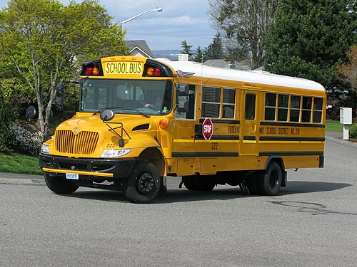

# North & Central America — recognition notes

## United States

The country is easy; the **state** is the puzzle. State-level filters:

- **License plates** (colour/design per state — [Wikipedia state plate gallery][plates]).
- **Road signage details**: county route shields, state route shield *shapes* (circle = ...
  varies per state; the shield shape is a state fingerprint — [MUTCD sign charts][mutcd]).
- **Phone area codes** on business signs ([NANPA lookup][nanpa]).
- **Terrain/vegetation**: saguaro = AZ/Sonora; Spanish moss = Deep South; palmetto = FL/SC.
- **Architecture**: adobe = NM/AZ; triple-deckers = New England; shotgun houses = LA.
- Yellow school buses, mailboxes with flags, wide lanes, strip malls = US baseline.

*The US/Canada baseline tell ([Wikimedia Commons](https://commons.wikimedia.org/wiki/File:IC_CE_school_bus_(shortened_chassis).jpg), CC).*

## Canada

- Bilingual signage in QC/NB (French-first in Québec[^bill101]); green km/h speed tabs.
- Provincial plates; "RR" rural route grids on the Prairies; Canadian Shield lakes+conifers.
- Separate from US fastest by: km/h limits, bilingual packaging on ads, plate shape usage.

## Mexico

- Yellow centre lines; "CUOTA/LIBRE" toll signage; topes (speed bump) warning signs;
  white-green federal highway shields; VW Beetle/Combi density (older imagery);
  colourful render + rebar roofs; OXXO shops.[^mx]

## Central America & Caribbean

- **Guatemala**: chicken buses (painted ex-US school buses); volcanos on horizon.
- **Costa Rica**: "Pura Vida" tourism signage, no army references; orange CR plates style.
- **Panama**: Panamericana signage, red devils buses (older), US-style infrastructure.
- **Caribbean LHT islands** (Jamaica, Barbados, T&T, Bahamas…) vs **RHT** (Dominican Rep.,
  Cuba, Puerto Rico) — driving side + plate + language triangulates fast.
- **Cuba**: classic 1950s US cars, near-zero ads, CDR murals; limited official SV.

[plates]: https://en.wikipedia.org/wiki/Vehicle_registration_plates_of_the_United_States
[mutcd]: https://mutcd.fhwa.dot.gov/
[nanpa]: https://nationalnanpa.com/
## Complete coverage — the remaining countries & territories

| Country | Where / Recognition |
|---|---|
| **Belize** | Caribbean coast of Central America — the only **English-speaking** country there; BZ plates; wooden stilt houses |
| **Honduras / El Salvador / Nicaragua** | Blue-white-blue flag family; separate via plates, volcano profiles (SV), Lake Nicaragua |
| **Haiti vs Dominican Republic** | One island (Hispaniola): French/Creole + tap-taps (HT) vs Spanish + American-style highways (DO) |
| **Puerto Rico** | US territory: Spanish signage with **US-style signs and plates** — that mix is the tell |
| **Cuba** | 1950s US cars, near-zero advertising, CDR murals; limited official coverage |
| **Bermuda** (LHT) | Atlantic, not Caribbean; white stepped limestone roofs (rain catchment) — unique |
| **Bahamas / Caymans / Turks & Caicos** (LHT) | British-style left driving with US-style cars |
| **Guadeloupe / Martinique** | **France overseas**: French plates, euro prices, Total stations in the tropics |
| **Curaçao / Aruba / Sint Maarten** | Dutch Caribbean: Dutch colonial pastel waterfronts, guilders/florins |

[^bill101]: Québec, [Charter of the French Language](https://www.legisquebec.gouv.qc.ca/en/document/cs/C-11).
[^mx]: PlonkIt, [Mexico guide](https://www.plonkit.net/mexico) — photo-documented.
